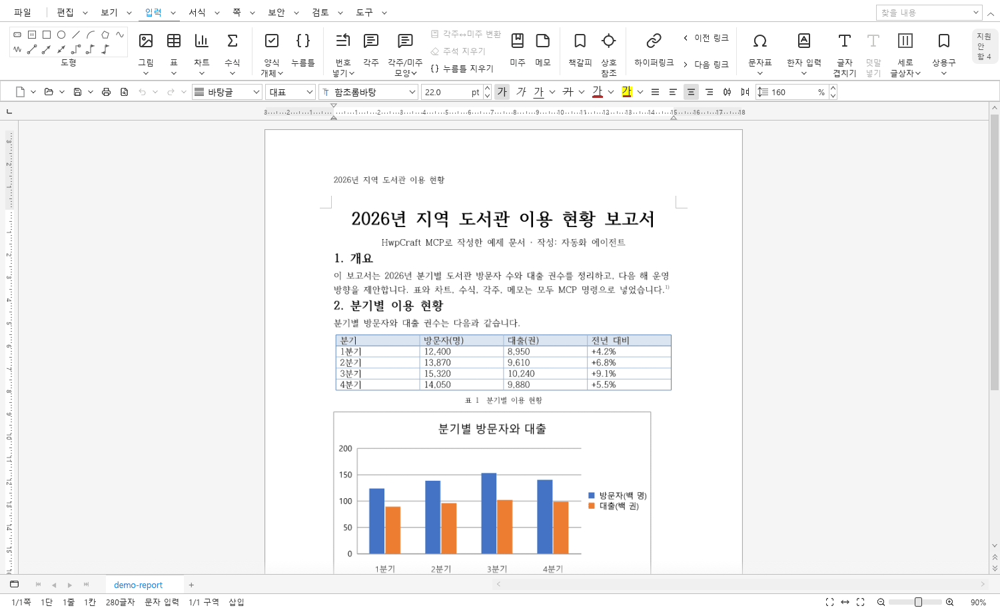
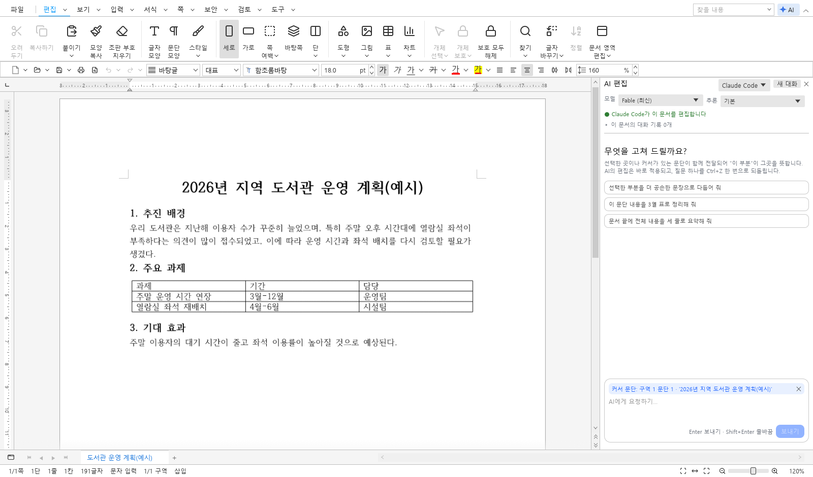
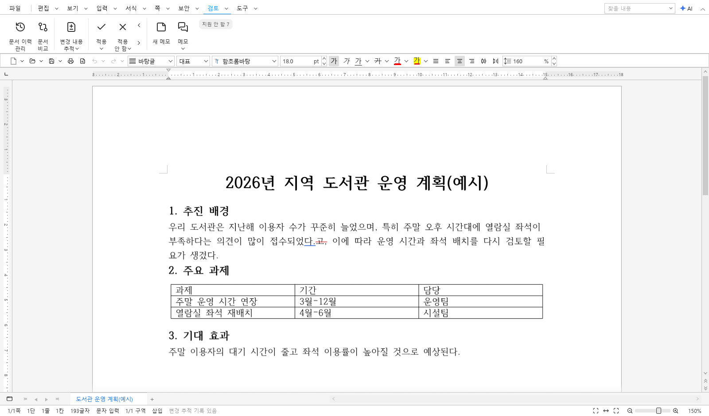
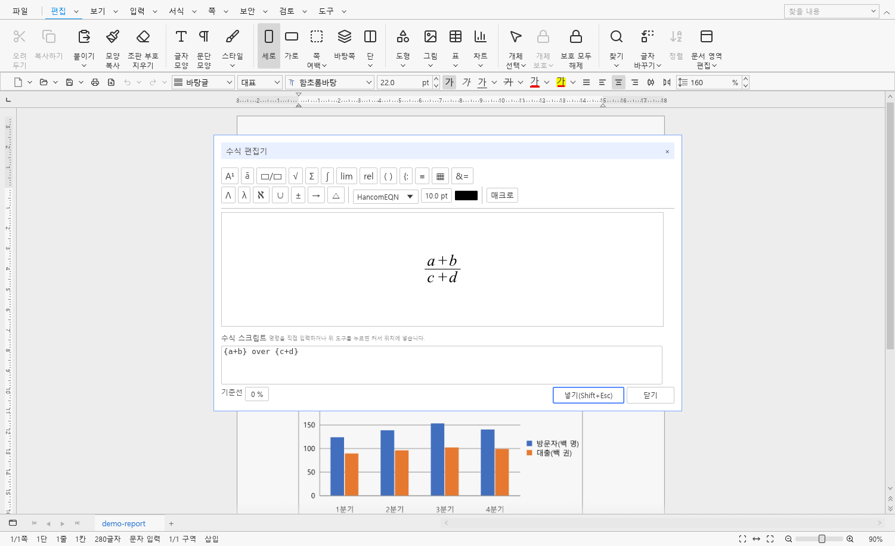
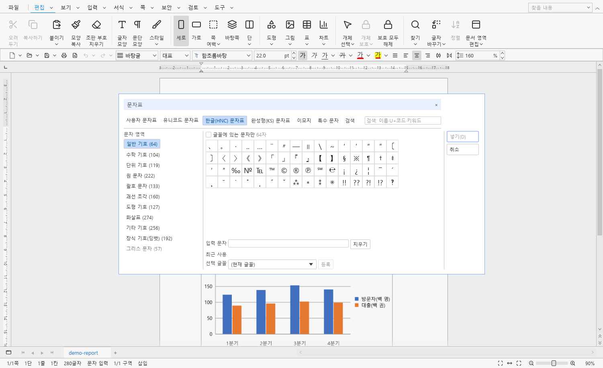
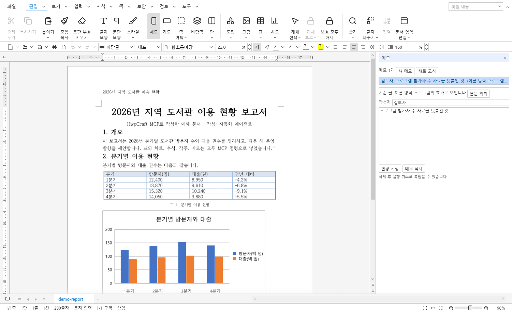
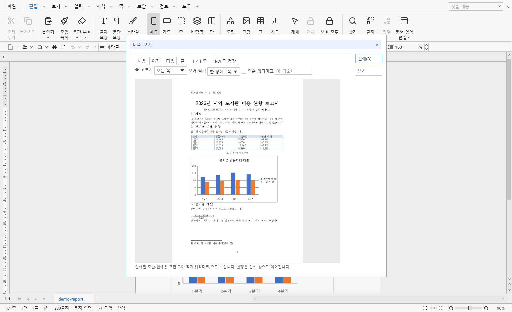
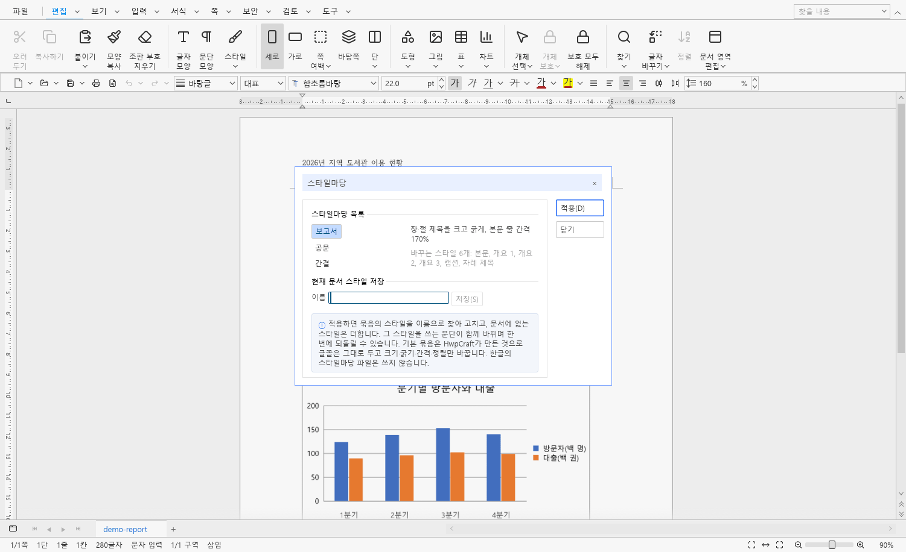
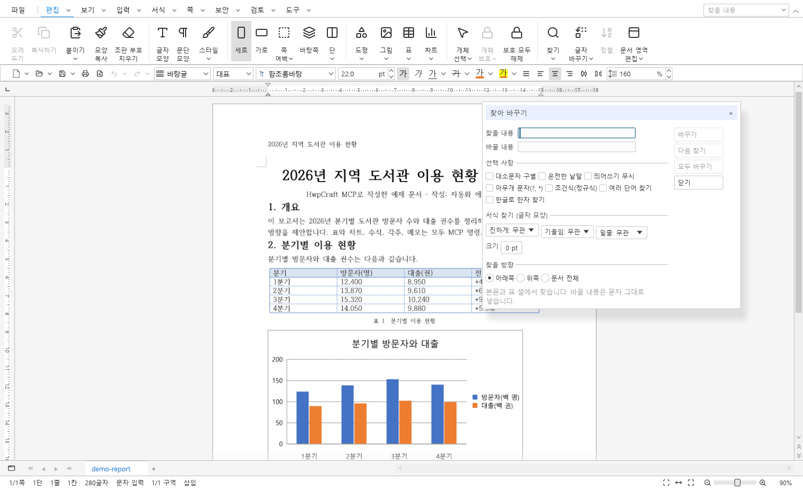
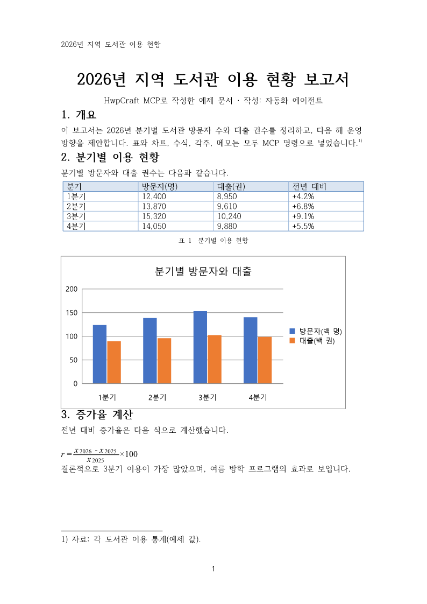

# HwpCraft

[한국어](README.md) · **English**

**An open-source native editor that opens, edits and saves Korean HWP / HWPX documents — and a document engine that lets AI agents write Hangul documents through MCP and finish them as reports.**

Version **0.22** (latest release [0.22](https://github.com/webvine/hwpcraft/releases/tag/v0.22)) · MIT License · Windows · macOS · Linux · Rust



*A report made only with MCP commands, opened in the desktop app (Insert tab). The table, chart, footnote and header were all added through MCP.*

## What is HwpCraft?

HWP is the most widely used document format in Korean government and business, yet the tools that edit and automate it are mostly closed. HwpCraft is a Rust program that works with HWP and HWPX documents directly on your machine, and it offers the same editing engine in three ways:

- **Desktop editor** (`hwpcraft`): edit documents with a Hangul-style ribbon, dialogs and shortcuts.
- **Command-line tool** (`hwpcraft-cli`): inspect, convert, render pages and batch-edit from JSON command files.
- **MCP server** (`hwpcraft-cli mcp`): exposes all 415 editing commands so AI agents such as Claude can create, edit, save and export documents to PDF.

It takes its application structure from the ArtCraft team's [WordCraft](https://github.com/storytold/wordcraft), its Hangul editing capabilities from the [RHWP](https://github.com/edwardkim/rhwp) document engine, and its user interface from [egui](https://github.com/emilk/egui). Both WordCraft and RHWP are MIT-licensed.

HwpCraft is an independent open-source project. It is not affiliated with, endorsed by, or derived from Hancom Inc. It ships no Hancom code, icons, logos or fonts. **It is not a 100 % replacement for Hancom Office Hangul.** Unimplemented features and known differences are listed under [Scope and limits](#scope-and-limits) rather than hidden.

License: **MIT** ([LICENSE](LICENSE)). See the [License](#license) section for scope and third-party components. Contributions: [CONTRIBUTING.md](CONTRIBUTING.md).

## Highlights

- **Works on HWP / HWPX in their own model.** RHWP's document model is opened and saved as is, without conversion, so original objects survive as far as the engine allows. Opens Word (DOCX) documents converted to HWP, exports PDF, DOCX and text, renders pages to PNG, and opens password-protected documents.
- **A screen familiar to Hangul users.** Menu and contextual tabs, a ribbon that folds in narrow windows, format toolbar, rulers, continuous page view, Hangul-style shortcuts (including prefix chords such as Ctrl+K,…) and the Windows Korean IME.
- **The editing a report needs.** Character and paragraph shapes, styles and style sets, tables (cell blocks, merging, formulas, table styles), pictures, shapes, text boxes, equations, 15 chart types, footnotes and endnotes, headers and footers, page numbers, columns, master pages, tables of contents, cross-references and indexes, memos with replies, find / replace, document compare and merge, hanja conversion and a character map.
- **MCP for AI automation.** An MCP server over stdio and loopback HTTP that takes both the current `2026-07-28` clients and 2025-era ones (2025-03-26, 06-18, 11-25; checked with Claude Code and the Codex CLI in 0.20). Engine commands run through `execute` / `batch`; Hangul automation action names and public ParameterSets run through `hwp_action`. It can also attach to a running desktop window so an agent and a person edit the same document.
- **AI edit panel (0.21).** Ask the locally installed and signed-in Claude Code or Codex in the panel on the right, and it edits the open document at once through MCP. The selection, or the paragraph holding the caret, is sent along, so "this part" means that place; all edits from one question undo with a single Ctrl+Z. The commands it ran are folded into one line, and a running answer can be stopped. View → AI editing panel (✦ AI on the menu bar) shows or hides it; whether it is open and its width (260–560 px) are remembered. While the AI edits, typing, clicks, editing commands, opening and new documents wait (scrolling, zoom and view commands still work), and the status bar says so. The panel lets you pick the model and reasoning level; the newest model is the default (for Claude Code the latest Fable, Opus, Sonnet or Haiku model, for Codex the first model in the list Codex provides). Conversations are kept per document: when a saved document is opened again (and has not changed since), its last conversation reopens in the panel, and others can be picked under "Conversations about this document" and continued.Each answer lists the places it changed; clicking one moves the caret there, and Revert takes back just that question. Optionally, a question that only changed text is left as tracked changes (author "AI · Claude Code" or "AI · Codex"), so you can accept or reject each change on the Review tab.
- **Edits that never break your document.** Saves are written to a temporary file and swapped in. A failed command leaves the document and undo history untouched, and `batch {atomic:true}` rolls everything back when any step fails.
- **Fully offline.** No login, server or database; documents never leave your machine. MCP over HTTP listens on 127.0.0.1 only and requires a token.

## A look around


*AI edit panel (0.21): Claude Code asked to tidy the selected paragraph. The changed text stays as tracked changes to accept or reject on the Review tab, and one Ctrl+Z takes the question back. Example document and example question.*

| | |
|---|---|
|  |  |
| **AI edit panel** — pick the engine and model; the selection or the caret's paragraph goes along as context. | **Reviewing AI changes** — accept or reject the AI's changes one by one on the Review tab. |
|  |  |
| **Equation editor** — write equations with tool buttons and script, and edit them right in the preview. | **Character map** — Hangul's four character tables, emoji, search by name or code. |
|  |  |
| **Memos** — attach memos to text ranges and edit author and text; replies work too. | **Print preview** — check n-up, watermark and page selection before printing. |
|  |  |
| **Style sets** — pick a set of styles and restyle the document at once. | **Find and replace** — ignore spaces, wildcards, regular expressions, hanja and format conditions. |

## Download

Get the bundle for your system from [GitHub Releases](https://github.com/webvine/hwpcraft/releases). Each bundle holds the desktop app `hwpcraft`, the command-line tool `hwpcraft-cli` and the license files.

| System | File | First run |
|---|---|---|
| Windows x64 | `HwpCraft-0.22-windows-x64.zip` | Unzip and run `hwpcraft.exe` |
| macOS Apple silicon | `HwpCraft-0.22-macos-arm64.tar.gz` | Right-click `HwpCraft.app` → Open (not signed or notarized) |
| macOS Intel | `HwpCraft-0.22-macos-x64.tar.gz` | Same as above |
| Linux x86_64 | `HwpCraft-0.22-linux-x64.tar.gz` | `./install.sh` installs into `~/.local`; needs a Korean font (`fonts-noto-cjk` or `fonts-nanum`) |

To build from source, see [Build](#build).

## Quick start

### Desktop

```text
hwpcraft report.hwp
hwpcraft ./samples/HwpCraft-시작하기.hwpx
```

`samples/` holds HWP, HWPX and PDF examples made with HwpCraft itself.

### Command line

`hwpcraft-cli` analyses, converts, renders and edits documents with the same engine as the desktop app:

```text
hwpcraft-cli --help
hwpcraft-cli commands [query] [--json]        # editing commands (--json: parameter help and examples)
hwpcraft-cli actions  [query]                 # Hangul action names and their commands
hwpcraft-cli info  input.hwp
hwpcraft-cli convert input.hwp output.hwpx
hwpcraft-cli render input.hwpx page.png 1     # all for every page, --scale 0.25–2
hwpcraft-cli run input.hwpx document.text '{"limit":20}'          # one command, result only
hwpcraft-cli run input.hwpx text.insert '{"text":"Hello"}' -o out.hwpx
hwpcraft-cli edit --new commands.json output.hwpx
hwpcraft-cli mcp --help                       # MCP server
```

The `edit` command file is a JSON array such as `[{"command":"text.insert","params":{"text":"Hello"}},{"hwpAction":"MoveDocEnd"}]` (`-` reads standard input), limited to 1 MB / 1,000 commands. By default the output file is written only when every command succeeds; with `--keep-going` failed commands are skipped, the file is saved and the exit code is 1. `run` executes one command (or one Hangul action name) and prints its result as JSON, saving only with `-o`. `commands --json` and `actions` list parameter help, examples and action mappings as MCP does. Exit codes: 0 success, 1 failure, 2 usage error. `--password` opens a protected document, and `--new-password` / `--remove-password` change or remove the password on save. Text offsets count Unicode scalar values.

### Let an AI write documents through MCP

Register `hwpcraft-cli` as a stdio server in your MCP client. Give the executable as an absolute path and name the folders the agent may read and write:

```json
{
  "mcpServers": {
    "hwpcraft": {
      "command": "C:/Tools/HwpCraft/hwpcraft-cli.exe",
      "args": ["mcp", "--transport", "stdio",
               "--automation-read-root", "C:/work/reports",
               "--automation-write-root", "C:/work/reports"]
    }
  }
}
```



*Page 1 of the report above, drawn by MCP `render_page`. Applying a style set, typing text, filling the table (`table.cells.set`), a table style, a caption, the chart (`chart.create`), the equation, footnote, memo, header and page number were all done by calling MCP tools from the official Python SDK.*

A typical agent session: `new_document` returns a `document_id`; `type_text` adds text; `execute` / `batch` apply formatting, tables, pictures and page setup; `render_page` draws pages to check them; `save_document` writes HWP / HWPX and exports PDF. `list_commands` finds commands and their parameters.

`hwpcraft-cli mcp` is a headless MCP server for `2026-07-28` and 2025-era clients (stdio by default; `--transport http --listen 127.0.0.1:7082` serves loopback HTTP, where every request needs `Authorization: Bearer <token>` with the token read from `mcp-http-token` in the settings folder or `--auth-token-file`, created readable only by you if missing): create Korean documents, edit text / formatting / tables / objects, save HWP / HWPX, export PDF / TXT, render PNG for checking, and restrict read / write roots. `hwp_action` accepts Hangul automation action names (`MoveLineEnd`, `CharShapeBold`, `DeleteWord` and many more) and some public ParameterSets, and runs the matching command; a registered name does not mean every original option is equivalent. `batch {atomic:true}` rolls every document change back when any command fails. Every tool declares an `outputSchema` for its structured result; for `execute` and `batch`, whose result depends on the command, only the common envelope is fixed. With **MCP 연결** (Tools tab) the desktop app serves the same protocol from its window on `127.0.0.1:7083` (same token); clients find the window's document with `list_documents` and edit it by that `document_id`, the window shows each edit at once and undo reverts it, and MCP cannot close it. It does not control Hancom software. Connections were checked with the official Python SDK `mcp` 2.3.0 and the TypeScript SDK `@modelcontextprotocol/client` 2.4.0.

More: [MCP connection and usage](docs/mcp.md), [command parameters and the report-writing recipe](docs/mcp-commands.md) (Korean).

## Final goal

The final goal of HwpCraft is for **an AI agent to write Hangul (HWP / HWPX) documents through MCP and finish them as reports, exported and ready to deliver, without a person at the keyboard**. The desktop editor is where people review and touch up the result; the centre of automation is the MCP server provided by `hwpcraft-cli mcp`.

To get there, HwpCraft aims to complete the following as fully as possible.

- **Expose the whole writing and editing workflow as MCP commands** — new documents, text input, character and paragraph shapes, styles, tables, pictures, charts, equations, footnotes and endnotes, headers and footers, page numbers, columns, bookmarks, hyperlinks, find / replace, hanja conversion, autotext and document comparison: everything the desktop can edit, an agent must be able to edit too. Hancom Office Hangul automation action names are accepted as they are (`hwp_action`) so existing macro and script knowledge carries over.
- **Provide the building blocks of reports** — cover pages, tables of contents, heading hierarchies, numbering, table and figure captions, references, page setup and print layout, assembled by commands, with templates and styles for consistent documents.
- **Automate output and verification** — save as HWP / HWPX, export PDF, render PNG to check the result, and roll the document back when any step of a `batch` fails so that no broken output is left behind.
- **Stay compatible with Hancom Office Hangul** — save exactly what Hangul reads and writes, on top of the RHWP engine, and record unsupported features honestly under [Scope and limits](#scope-and-limits) instead of hiding them.

Progress is tracked under [Features](docs/FEATURES.en.md) and in the release notes (`docs/`); remaining items live in the limits section.

## How HwpCraft is built

HwpCraft combines two open-source projects. This section states which part comes from where.

- **Application structure from ArtCraft** — HwpCraft follows the crate layering of [WordCraft](https://github.com/storytold/wordcraft) (MIT) by storytold's ArtCraft team: `doc` → `formats` → `render` → `engine` → `mcp` / `ui-egui` → `apps`. Ribbon width planning (`crates/ui-egui/src/ribbon_layout.rs`), safe file replacement (`crates/formats/src/file_access.rs`) and the MCP server's lifecycle / tools / session structure are adapted from WordCraft; the theme tokens follow DesignCraft and the dialog draft / commit pattern follows DeckCraft. The skeleton and workflow of the application belong to the ArtCraft family.
- **Hangul editing capabilities from RHWP** — HwpCraft calls [RHWP](https://github.com/edwardkim/rhwp) (MIT) directly for the HWP / HWPX parser and document model, typesetting, saving, SVG rendering, PDF export, and editing APIs such as character and paragraph shapes, tables, objects, footnotes and endnotes, headers and footers, page numbers, columns, bookmarks, hyperlinks, document passwords and privacy scanning. RHWP's document model is kept as is rather than converted into WordCraft's DOCX model. The ability to read, edit and save documents belongs to RHWP.
- **What HwpCraft implements itself** — the `Session` and command protocol that join the two (Unicode scalar offsets, table-cell addressing, selection / clipboard / caret, undo transactions), the per-area command modules that group RHWP APIs into Hangul-style commands, the Hangul-style ribbon, dialogs, shortcuts and IME handling, features RHWP does not provide (find / replace, sort, control-mark removal, character map), and the CLI and MCP surfaces.

No Hancom code or resources are used in any layer. Hancom Office Hangul is the reference for the behaviour and layout users expect, not a source of code.

```text
apps/hwpcraft (desktop)             apps/hwpcraft-cli (CLI · MCP entry)
        │                                   │
crates/ui-egui (ribbon, dialogs, IME)  crates/mcp (stdio / HTTP MCP server)
        └──────────────┬────────────────────┘
               crates/engine (Session · editing commands · undo)
                       │
     crates/render ── crates/formats ── crates/doc
                       │
          RHWP (../rhwp: HWP/HWPX model, typesetting, saving, SVG/PDF)
```

## Features at a glance

| Area | What you can do |
|---|---|
| Files | Open HWP, HWPX and HWP3; import Word (DOCX); save HWP and HWPX; export PDF, DOCX and TXT; render pages to PNG; password-protected documents; save a block, insert a file; auto-recovery; document templates |
| Editing | Multi-paragraph selection, Hangul-style caret and delete shortcuts, 40 undo steps, copy / paste with formatting (HTML), pasting pictures and picture files copied in other programs, dropping picture files on the document (where they are let go on Windows, at the caret on macOS and Linux), find / replace (including headers, notes and text boxes), character map, autotext, key macros |
| Formatting | Character and paragraph shapes, styles and style sets, bullets and numbering, outline numbering, tabs, borders and backgrounds, highlighter, ruby text, drop caps |
| Tables | Create, select cell blocks, merge and split, row / column editing, formulas, table styles and user table styles, draw / erase, nested tables, captions |
| Objects | Pictures (with effects), shapes, text boxes, connectors, equation editor, 15 chart types, form objects, group / order / align / lock |
| Page and print | Page setup, page numbers, headers and footers, columns, sections, master pages, line numbers, page borders and backgrounds, print preview, n-up printing and watermarks |
| Review and tools | Memos and replies, tables of contents / tables / figures, cross-references, indexes, document compare and merge, hanja conversion, find and mask personal information, statistics |
| Automation | CLI batch editing, 16 MCP tools and 415 editing commands, Hangul automation action names (`hwp_action`) |

The detailed list is in [Features](docs/FEATURES.en.md).

## What changed in 0.22

- **Word (DOCX) conversion**: `.docx`, `.docm` and `.dotx` open as Hangul documents, and documents export to DOCX (WordCraft's DOCX reader and writer). Character and paragraph shapes, numbering, tables, pictures, shapes and text boxes, headers and footers, page numbers, footnotes and endnotes, memos, sections and columns go both ways; whatever cannot be carried over is listed.
- **Headers and footers edited on the page**: double-click the area to edit it in place (typing, selection, Ctrl+B/I/U, undo, the Header/Footer context tab). Pictures, shapes and tables in a header can be picked, moved, resized and given new properties.
- **Printing and PDF**: direct printing to the chosen printer on Windows (GDI, paper, orientation, copies), the print range "current section", PDF document information and outline bookmarks, and word spaces kept when text is copied from a PDF.
- **AI editing**: files attached to a question (button, drag and drop, Ctrl+V), document pictures replaced with an attached picture (`picture.replace`), and a command that puts a field into a header.
- **Dropping pictures**: picture files dropped on the document go in where they are let go (Windows) or at the caret (macOS, Linux), with a label at the pointer saying what letting go does.
- **Speed and fixes**: undo and redo re-lay out only the changed paragraphs (215-page document 178.6 → 9.8 ms). Fixed the caret and click position in paragraphs with objects treated as characters, ↓/↑ in paragraphs running over pages, tables overlapping the next paragraph, table width in multi-column sections, and merges copied when rows or columns are inserted.

Full details are in the [0.22 release notes](docs/RELEASE-0.22.md).

## What changed in 0.21

- **AI edit panel**: ask Claude Code or Codex in plain words in the panel on the right of the window, and it edits the open document through MCP. Selection or caret-paragraph context, one Ctrl+Z per question, commands folded into one line, Stop, model and reasoning level. Conversation history (kept per document, reopened and continued), the places each answer changed with Revert, and text-only questions left as tracked changes.
- **Safeguards**: each question gets a one-time token and edits only this window's document; saving, opening, writing or reading files, writing the settings folder, passwords and undo / redo (41 commands) are refused on every path, and other MCP clients may only read that document meanwhile. Claude Code runs with its built-in tools and user settings off, Codex with its own settings and the shell off.
- **Command line**: `run` executes one command and prints its result, `commands --json` gives parameter help and examples, `actions` finds Hangul action names, `edit` takes stdin, Hangul action steps and `--keep-going`, `render all --scale`, passwords changed or cleared on save, exit code 2 for usage errors. CLI completeness on the same items as MCP and the desktop: 64% → 100%.
- **Fixes**: the header / footer cache no longer uses another section's entries after sections are inserted or removed (RHWP 0103), and shortcut text in notices shows ⌘ on macOS.

Full details are in the [0.21 release notes](docs/RELEASE-0.21.md).

## Version history

Versions increase as `0.10 → 0.11 → 0.12 …` (`x.xx`; Cargo uses `0.10.0` internally).

| Version | Main changes |
|---|---|
| [0.22](docs/RELEASE-0.22.md) | Word (DOCX) import and export, headers and footers edited on the page, direct printing on Windows and PDF bookmarks, AI attachments and picture replace, dropping pictures, faster undo |
| [0.21](docs/RELEASE-0.21.md) | AI edit panel (Claude Code, Codex, conversation history, tracked changes), AI run safeguards, command-line `run` and `actions` |
| [0.20](docs/RELEASE-0.20.md) | Track changes (view, accept / reject, record), vertical body text and manuscript paper, sections carrying master pages on, 2025-era MCP clients, interface cleanup, faster saving, undo and scrolling |
| [0.19](docs/RELEASE-0.19.md) | Wider Hangul editing (tables of contents, cross-references, indexes, style sets, form objects, 15 chart types and more), matching MCP commands, faster layout, replace-all and PDF |
| [0.18](docs/RELEASE-0.18.md) | 11 chart types, failed atomic batches restore undo history and clipboards, MCP Tasks, `outputSchema` and progress notifications, faster editing, opening and PDF, UI cleanup |
| [0.17](docs/RELEASE-0.17.md) | Pending input formatting, editing headers, footers, text boxes and notes in place, MCP 2026-07-28 (per-document workers, HTTP token authentication), Windows, macOS and Linux packages |
| [0.16](docs/RELEASE-0.16.md) | Body memos, address-based nested-table editing, dynamic body page numbers, a subset of public automation parameters |
| [0.15](docs/RELEASE-0.15.md) | Paragraph moves, shared highlighter output for screen, PNG and PDF |
| [0.14](docs/RELEASE-0.14.md) | Caret, selection, clipboard and Hangul key behaviour, more formatting, tables, objects and page features, hanja conversion, document compare, autotext, `hwp_action` |
| [0.13](docs/RELEASE-0.13.md) | Previously unused RHWP APIs (password documents, privacy search and more), macOS and Linux support |
| [0.12](docs/RELEASE-0.12.md) | Document scroll bars and document-tab layout |
| [0.11](docs/RELEASE-0.11.md) | Cell padding from the ruler, page-corner marks |
| [0.10](docs/RELEASE-0.10.md) | Version scheme, Ctrl+wheel zoom |

Plans for later versions are in the [feature roadmap](docs/FEATURE-ROADMAP.md) (Korean).

## Build

Rust 1.98.1, pinned in `rust-toolchain.toml`. Windows x64 needs MSVC and the Visual Studio C++ build tools; macOS needs the Xcode command-line tools; Linux needs a C compiler plus X11 / Wayland and OpenGL development packages; file dialogs use xdg-desktop-portal (shipped by GNOME and KDE), so no GTK development packages are needed. `HwpCraft.ps1` (Windows) and `hwpcraft.sh` (macOS / Linux: `build`, `test`, `install`, `start`, `status`) wrap the same Cargo commands.

Windows installer: `scripts/build-installer.ps1` stages the same files as `HwpCraft.ps1 Install` and compiles `packaging/windows/HwpCraft.iss` with Inno Setup 6 into `output/installer/HwpCraft-<version>-windows-x64-setup.exe` (optional desktop shortcut and `.hwp` / `.hwpx` association).

Platform status (0.22): Windows x64 is fully tested, including clippy and the real desktop window, and Linux x86_64 ran the workspace tests for real under WSL. macOS (arm64 and x64) and Linux x86_64 run the workspace tests in the GitHub Actions release build; the desktop window has not been checked by hand on a Mac or a Linux desktop. Fonts come from a per-OS candidate list (Windows 맑은 고딕, macOS Apple SD Gothic Neo, Linux Noto Sans CJK KR / NanumGothic …), first installed wins. Linux needs a Korean font (`fonts-noto-cjk` or `fonts-nanum`); without one only Latin text and digits show, and Hangul appears only if another installed font covers it. The settings folder is `%APPDATA%\HwpCraft` on Windows, `~/Library/Application Support/HwpCraft` on macOS (an existing `~/.config/HwpCraft` keeps being used) and `$XDG_CONFIG_HOME/HwpCraft` or `~/.config/HwpCraft` on Linux. On macOS shortcuts use Cmd (⌘) instead of Ctrl. The macOS app is not signed or notarized: on first launch right-click → Open, or run `xattr -d com.apple.quarantine HwpCraft.app`; opening documents by double-clicking in Finder is not supported (open them from the app). On Linux, unpack the bundle and run `./install.sh` to install into `~/.local`. Launcher registration and portable ZIP packaging exist in the Windows script only.

HwpCraft depends on RHWP as a **sibling path dependency** (`../rhwp`, pinned to RHWP **v0.8.7**, commit `1a76570e`), and on WordCraft the same way for DOCX reading and writing (`../wordcraft`, the commit in `WORDCRAFT_REV`). Clone the three repositories next to each other:

```text
git clone https://github.com/webvine/hwpcraft.git
git clone --branch v0.8.7 https://github.com/edwardkim/rhwp.git
git clone https://github.com/storytold/wordcraft.git
git -C wordcraft checkout $(cat hwpcraft/WORDCRAFT_REV)
cd hwpcraft
cargo build --release --locked -p hwpcraft -p hwpcraft-cli
cargo test --locked --workspace
cargo clippy --locked --workspace --all-targets -- -D warnings
```

One engine test opens a chart sample from `../rhwp/samples`, so the RHWP checkout must include its `samples` folder. HwpCraft's local RHWP patches live in `patches/rhwp/`; apply them before building with `pwsh -File scripts/rhwp-patches.ps1 -Mode Apply` (`scripts/sync-siblings.ps1` re-applies them after updating RHWP). On Windows, `HwpCraft.ps1` (`Build`, `Test`, `Install`, `Start`, `Status`) wraps the same commands and uses `../.build/hwpcraft` as the Cargo target directory; the `Launcher` and `Install` actions target a local launcher that is not part of this repository.

Run the desktop app:

```text
hwpcraft ./samples/HwpCraft-시작하기.hwpx
hwpcraft ./samples/HwpCraft-시작하기.hwpx --view replace --screenshot out.png --exit-after-screenshot
```

`--view` opens a dialog or ribbon tab directly for visual checks (for example `character`, `paragraph`, `table-create`, `page-setup`, `find`, `replace`, or a ribbon tab name such as `insert`).

Do not run `cargo fmt --all`: it follows the path dependency into RHWP. Format the HwpCraft packages with explicit `-p` arguments.

## Repository layout

| Path | Role |
|---|---|
| `crates/doc` | Document engine façade, Unicode cursor and table-cell addressing |
| `crates/formats` | HWP / HWPX load and save, PDF / TXT export, safe file replacement |
| `crates/render` | RHWP SVG → page bitmaps via resvg, hairline handling, installed font list |
| `crates/engine` | Session and command protocol, selection / clipboard / caret, find, sort and control marks, tab widths, formatting, tables and objects, page services |
| `crates/mcp` | stdio JSON-RPC MCP server: headless editing, tools, resources, command help |
| `crates/ui-egui` | Main window, continuous page view, keyboard / IME, ribbon, toolbars, rulers, status bar, dialogs |
| `apps/hwpcraft` | eframe / glow desktop executable |
| `apps/hwpcraft-cli` | Analysis, conversion, PNG rendering and batch-edit CLI, MCP entry point |
| `samples` | HWP / HWPX / PDF examples generated by HwpCraft itself |
| `docs` | Design notes, verification records and release notes (Korean) |

Feature areas plug in through `extensions.rs`, so each area adds its own commands, dialogs and shortcuts in its own files.

## Documentation

| Document | Contents |
|---|---|
| [Features](docs/FEATURES.en.md) | Detailed feature list by area |
| [MCP connection and usage](docs/mcp.md) | Connecting, metadata, document handles, tools, file permissions, Tasks (Korean) |
| [MCP command parameters](docs/mcp-commands.md) | Parameters and examples per command, report-writing recipe (Korean) |
| [MCP implementation](docs/mcp-implementation.md) · [MCP verification](docs/mcp-verification.md) | Server structure and verification records (Korean) |
| [Table interaction](docs/TABLE-INTERACTION.md) | Selecting, moving and resizing tables (Korean) |
| [Feature roadmap](docs/FEATURE-ROADMAP.md) | Plans for later versions (Korean) |
| [Release notes](docs/RELEASE-0.19.md) | Changes per version (`docs/RELEASE-0.xx.md`) |

## Scope and limits

### Not implemented (disabled in the ribbon and menus)

- AI edit panel: needs the Claude Code or Codex CLI installed; it does not call an API key directly. The AI cannot save, open, export to files or insert pictures from files (a picture attached to that question it can insert, or put in place of a body or header picture; a follow-up question needs it attached again), and while it answers it edits only this window's document (other MCP clients can only read it meanwhile; an edit another client sent just before the question may end up in that question's undo step). Codex runs with its own settings with the shell turned off, and a Codex version whose shell cannot be turned off is not used. If Codex refreshes its sign-in token during a run, the new token is written back to the user's `~/.codex/auth.json`. To continue conversations, each CLI keeps its conversation record (including the document text sent as context and the attached contents) in its own folder. No context is sent while the caret is in a table inside a table or in a text box. Attachments (0.22): up to 5 per question, up to 20 MB each. Pictures (PNG, JPG, GIF, BMP) are scaled to 1568 px on the long side and sent as pictures; text files (TXT, MD, CSV, JSON, HTML and similar) and documents (HWP, HWPX, DOCX) are read by HwpCraft and their text put into the question (50,000 characters per file, 100,000 in all; the rest is cut). Distribution (배포용) and password-protected documents, PDF and WebP cannot be attached, and the AI never opens the files itself. Files dropped on the AI panel's input box are attached (with a document among them it asks whether to open it or attach it). HwpCraft's conversation history keeps only the attached files' names.
- AI conversation history: questions, answers, the commands run and the text of changed paragraphs are stored in `ai-history` in the settings folder, readable only by the current user (0600 on Unix; the user-profile permissions on Windows). Nothing is written into the document file, and no MCP token or document id is kept. A document is recognized by its path and a fingerprint of its body text: a file moved or renamed shows as "may be the same document at another location", a file edited in another program as "the document has changed since", and another document with exactly the same text may look like the same one. In the panel the history can be turned off, and one conversation, this document's conversations or all of them can be deleted, by default together with Claude Code's and Codex's own conversation files. Changes are recorded as the text of body and table-cell paragraphs only: formatting, pictures and table structure do not appear under the changed places, and once the document has changed since, the panel neither reverts nor records as tracked changes a question that changed them or a paragraph holding an object (Ctrl+Z still works). AI changes are not mixed into a document that already has tracked changes, and when the same paragraph text appears in more than one place, Revert cannot tell which one and changes nothing.
- MCP: the desktop connection edits the one document open in the window; click / key / screen capture, remote authentication and a select-all extension are not done (the official conformance suite passes every scenario that has a fixture). Both MCP `2026-07-28` and 2025-era clients (2025-03-26, 06-18, 11-25) are served (checked with the Codex CLI, Claude Code and the Python SDK 1.x / 2.x in 0.20). Over stdio, requests sent to one document run in the order they were sent; requests sent concurrently over HTTP have no defined order, so wait for each answer or use batch. A window document's PDF export is prepared over several frames so the window keeps responding, but HWP / HWPX saves run at once (a little over a second for a large document). HTTP accepts loopback only (no standalone GET SSE stream) and uses an explicit ID per document; each MCP process is an independent headless session. Cancelling a request does not roll back a synchronous edit or file write that already ran; a save cancelled while running stops just before the file is replaced and leaves the existing file. Progress notifications for long operations report elapsed time every 5 seconds, not per-page progress. The Tasks extension applies to the open and save tools only, and task state is known only by polling tasks/get (no task notifications).
- Security: saving distribution documents (a distribution document opens read-only: viewing and page images only; editing, saving, copying, printing / PDF and text extraction are refused in the desktop, MCP and CLI), selected-text protection, removing private-information protection, changing its password and document security settings (Hangul's encrypted private-information field and these settings are not publicly specified, so they are not supported; such fields in existing documents are kept, and finding and masking private information is offered instead). Review/tools: proofreading marks, recording new document-history versions and viewing older ones (the recorded list is shown), recording format changes as tracked changes, spelling, Hangul's built-in quick-correction list (a user list works for text typed in the desktop only, undone by one Ctrl+Z), user dictionaries, translation, script (JavaScript) macros, citations (an index works since 0.19: index marks after a word as Hangul stores them, added, edited and removed with first and second keys in HWP/HWPX, and an index at the caret in Hangul 2024's default 색인 만들기 layout — first-sound groups, 'word<tab>page, page', second keys indented; Hangul makes it in a new document, HwpCraft at the caret, and paragraphs holding index marks cannot be brought in by document merge or formatted auto text. A table of contents can be made from outline paragraphs or styles, and a list of tables or figures from captioned tables or pictures; all are written as ordinary paragraphs in "차례 N" / "표 차례" / "그림 차례" styles, not as Hangul's table-of-contents field, and one refresh updates all three; each entry links to a bookmark at what it lists, in the bookmark-link form Hangul-saved documents use and as an in-document link in DOCX, and MCP / the engine follow them with the `hyperlink.jump` family, the desktop with Ctrl+click; in PDF, table of contents entries and cross references link to their page too (0.19, RHWP patch 0039; dropped on n-up sheets and for pages outside the PDF)) and preferences. Cross references insert and refresh the page of an outline heading, a captioned table or picture, or a bookmark, and a table's or picture's caption number (the bare number, as Hangul shows it) or whole caption (stored as Hangul's own cross-reference field in HWP/HWPX; picture references follow Hancom's published command format, and only the table form was checked in Hangul). Whether Hangul reads the HWPX form of a table number or caption reference as such has not been confirmed yet. Headings can be referenced by their visible number ("2.") and their text like tables and pictures (0.20, in the form Hangul 2024 was measured to use). Splitting a heading paragraph with Enter at its very start can break the cross references to that heading after an HWPX save; insert them again before refreshing. A cross reference can go inside a table cell (one level deep) and into a paragraph that holds an object such as a table, picture, bookmark or footnote, but not directly after such an object; place it one character away (RHWP patch 0067). If an object later ends up right after a reference, a refresh skips that reference and lists it under skipped. Refreshing date fields also covers fields in table cells one level deep. Key macros record editing commands, typing and caret/cell moves (not caret moves made with the mouse), are saved by name and run with one rollback if a step fails. Document comparison, Hanja conversion and AutoText have the limited implementations described below.
- View: dragging an object draws move guides that snap to the edges and centres of the page, the body and other objects (View → Guides; Alt moves freely). Window arranging stays inside the work area of the monitor the window is on, and minimising all windows is supported (checked on a single-monitor PC only; several monitors are tested by parsing and choosing only). On macOS, shortcuts in menus, tooltips and the status bar show ⌘. The desktop MCP connection can be on in several windows at once; the first takes port 7083, the next 7084 and so on up to 7099, and a client registers each window's address under its own name. View colours use screen post-processing. File: Hancom's built-in templates (the template gallery offers only templates the user saved); HML export of documents not opened from HML. Auto-recovery saves a copy of a changed document every 5 minutes while idle in the `recovery` folder of the settings folder and offers it after an abnormal exit; the original file is never touched.
- Page: drawing tables, pictures and footnotes in vertical-text sections. Vertical body text (Latin text rotated or upright; the characters per column and page match measurements in Hangul 2024), section start position (as is, odd or even; as in Hangul, the page number skips without an empty page), creation and save date fields in headers and footers, and manuscript paper (400 characters A4 portrait, 200 characters A4 landscape, one character per cell, two Latin letters or digits per cell, trailing spaces hang at the line end) are supported. A section break carries the previous section's master pages on, as in Hangul. Print: the print window lets you choose a printer (paper printing uses the operating system's print command). Labels (A4 label tables, adding a page), N-up (1, 2, 4, 8 pages per sheet), print-only watermarks, odd / even pages, reverse order and copies are supported. The empty paragraph after a label table is set in 1 pt type so the sheet stays one page even when the labels use almost the whole paper height; text typed below the table therefore shows very small. A sheet whose labels fill the full 297 mm leaves no room for that paragraph and gains an empty second page when it is saved and opened again.
- Format: Style import/export and style sets use HwpCraft JSON; Hangul's style-set files (.sty) and its built-in set list are not used.
- Tables and objects: photo editing, 3D line and surface charts, verified Hancom-native chart compatibility, WordArt and OLE. Bubble sizes change only through `chart.configure` (`chart.data` edits X/Y values); the desktop chart dialog creates all 15 kinds too (its preview shows 'building' for a moment when it first opens). Visual equation editing covers the caret, typing, slot navigation and drag selection in the preview (the script field below follows only the caret, not the selection). Vertical text boxes, object alignment/selection and existing form values have basic support. Connector anchors are exact for paper-anchored objects and may drift for paragraph-anchored ones; line end-point editing excludes inline lines and connectors.
- Documents created in HwpCraft (or HWPX files HwpCraft wrote) are saved to HWPX without line layout (linesegarray), so Hangul and HwpCraft lay them out afresh when opening. Documents opened from Hangul keep their stored line layout, but heavily edited paragraphs may still carry stale layout computed by RHWP.
- Tab drop-down lists are ribbon command lists, not Hangul submenus.
- Direct table dragging targets top-level tables. A table treated as a character goes to the body text position it is dropped on, as in Hangul (`object.move_inline`); a floating table moves by position. A table split over pages is dragged and resized as a whole too (`table.move`, keeping its reference). Table drawing and erasing work on tables with cell spacing too, on the cell grid of `table.info` (spacing not counted); RHWP draws the spacing inside the preceding cell, so no gap shows between cells.
- Cells of a table inside a table and text boxes are edited on the page since 0.19: a click there places the caret, and typing (including the Korean IME), Backspace, Delete, Enter (paragraph split), arrows, Home / End, Shift selection, Ctrl+Z, Ctrl+B / I / U, copy and paste work, each edit one undo step (RHWP patch 0046). Home / End go to the start / end of the line, a double / triple click selects the word / paragraph, Tab / Shift+Tab move to the next / previous cell of a nested table (a tab character in a text box), and the character and paragraph buttons of the ribbon and the formatting toolbar apply there too. Esc or a click in the body returns to the body caret. As in Hangul, a click on a text box's text places the caret there, a click near its frame (within 4 px) selects the box, and dragging a selected box moves it. A selection runs over the paragraphs of one cell or text box (not from one cell into another), and the character and paragraph format dialogs show and change the format there (0.20). Dragging into another cell of a nested table picks a cell block, and the ribbon's merge, split and row / column insert and delete work on that table (engine and MCP: `context.table.merge`, `split`, `insert_row`, `insert_column`, `delete_row`, `delete_column`, `cells` for borders and backgrounds, `info`; 0.20). Text boxes inside groups and the regions below use the menu that follows.
- Nested tables, headers / footers, text boxes and notes are edited from the Edit tab's **문서 영역 편집** (edit document regions) menu: character / paragraph format, split / merge, table create / delete. An object treated as a character is dragged to another text position (`object.move_inline`; at a memo or form-field start it goes inside, at its end outside), and several selected floating objects move together (`object.move_by`). Vertical text boxes are edited the same way (`context.v2.*`). Vertical headers / footers are still read-only. The body of a vertical-text section can be edited (↑↓ move within a column, ←→ between columns, and the caret is a bar across the column); nested areas inside it (table cells, text boxes) are read-only. In vertical-text sections centred and right-aligned paragraphs sit in the middle and at the end of their column; justified and distributed paragraphs start at the top without spreading the characters, and paragraph margins and indents do not move the column start (not compared with Hangul: no vertical sample). The public parameter sets `CharShape`, `ParagraphShape` and `TableCreate` list their supported fields through `hwp.parameters.schema`.
- The header / footer dialog (`page.header_footer.text`) handles one line of text with page number, total pages, date and file name fields (keeping the paragraph and character shape). A header or footer with a picture, table, shape, text box or equation, more than one paragraph, more than one character shape, or a tab or line break would lose it when rewritten, so the rewrite is refused (`lossless` / `lossy` in `page.header_footer.text.get`) and it is edited through **문서 영역 편집** (edit document regions, `context.v2.*`). Pictures, shapes and text boxes inside headers and footers are picked in header / footer editing (double-click the area) to move, resize, change their object properties or delete them; MCP uses the same object commands with an address carrying `header_footer` (`page.header_footer.object.list`). Tables inside headers and footers are picked by their frame for the table properties dialog, resizing, moving and deleting, and the ribbon picture, shape and table tabs act on a picked header object (group, ungroup, align, next / previous object and the table tabs' cell commands do not reach header objects yet). Cell text of tables inside headers and footers cannot yet be edited on the page (edit document regions and MCP `context.v2.*` do).
- Headers and footers are edited on the page: double-click the area to enter, Esc to leave. Typing, selection, the Korean input method, Ctrl+B/I/U, undo and the Header/Footer context tab (previous/next, header↔footer, both/odd/even pages, hide on this page) work there. Pictures and shapes in a header can be picked to move, resize, and change properties, placement and rotation. Text in header table cells and row/column commands are not there yet (0.23). The 문서 영역 편집 menu and the header/footer dialog are still available. While editing, the format bar and the character/paragraph format dialogs wait (Ctrl+B/I/U is the only character formatting), and distribution documents and hidden pages cannot be entered. Composition with the real Windows Korean input method has not been checked by hand (tests use input-method events).

### Remaining typesetting and save limits

- Memos have no resolved state, as Hangul has none. A memo across several paragraphs is created and deleted the way Hangul stores one, beginning in the first paragraph and ending in the last (body paragraphs of one section; replies to it are not supported yet). For a memo with replies, the HWPX end markers (fieldEnd) close the outer memo first while Hangul closes the inner one first; they pair by beginIDRef. Whether Hangul rewrites a last-save date field's text when it saves is not confirmed; HwpCraft updates only the summary times on save and the field text on refresh. Date fields follow Hangul's samples (no zero padding for month, day or hour) and write only the confirmed Command parameter to HWPX.

- Some HWP documents with many large tables break pages differently from Hangul. The .hwp of the 2025 행정업무운영 편람 handbook lays out to 381 pages, fewer than Hangul's 383 (384 without the KoPub fonts), because large rows that run over several pages inside a cell, such as the appendix regulation tables, are filled slightly further than in Hangul before they break; the same document as .hwpx gives 383 pages. In chapter 5 of the same handbook the question 51 table is drawn taller than in Hangul, so the tables on later pages are placed differently, and on page 299 of the .hwp the first piece of a table runs about 5 px past the body bottom because its last row is compressed. The difference comes from RHWP's HWP5 layout path and is a known RHWP issue (#6842).
- Picture effects (shadow, glow, soft edge, reflection) can be set with `picture.effects` and are saved, reopened and drawn in both HWP and HWPX (effects in documents opened from .hwp are drawn too; 0.20). The glow, soft-edge and reflection shapes and the effect colours written to HWP have not been compared with Hangul yet.
- DOCX export and import use [WordCraft](https://github.com/storytold/wordcraft)'s DOCX reader and writer (the commit in `WORDCRAFT_REV`; 0.22). **Export** writes character and paragraph formatting (Hangul keeps a font, width, spacing and size per script; a run is split by script where those differ), style names, paragraph numbers and bullets (Word list numbering), tables (merges, borders, fills, cell margins, floating table position), pictures (cropping, inline or floating with their placement), rectangles, ellipses, lines and text boxes (Word shapes, with their text as text), headers and footers (odd and even pages, hidden on the first page), page numbers, footnotes and endnotes, hyperlinks and bookmarks, memos (Word comments), columns and column breaks. Line spacing and the space between paragraphs on a page are written as Hangul laid them out. Page numbers that start again on a page with a page break, headers, footers and page numbers hidden page by page, the place of pictures in headers and footers (from the header area, as Hangul draws them), the width of the middle dot (Word draws a Korean face’s · full width, so it is written in Times New Roman) and the height of a one-row box table are kept. Equations become pictures, other drawing objects and charts are cut from the page image and placed as pictures, and the result lists what could not be written (MCP `omitted`, CLI stderr, the desktop message bar). Fonts only Hangul has (HFT, HCI) and fonts missing on this computer are written as the installed face RHWP draws with, or one of the same kind. **Import** converts `.docx`, `.docm` and `.dotx` when they are opened (desktop Open, MCP and CLI `file.open`): Word's document defaults, styles, direct formatting and table styles are resolved into character and paragraph shapes; style names, Word lists as paragraph numbers and bullets (with the text position after the number), tables (merges, borders, fills, percentage and automatic widths; rows break across pages; a thin rule row drawn as an empty paragraph with an exact line height stays thin), pictures, shapes and text boxes, grouped shapes (member by member), headers and footers (odd and even pages; pictures placed from the page or a margin go where Hangul draws them, from the header area), page numbers and page counts, footnotes and endnotes, hyperlinks and bookmarks, sections, columns and page breaks carry over. Word's line multiples become percentages with the font's own line height (1.3 times the Windows height for East Asian fonts, as Word does), and Hangul in a font without Hangul is set in Batang, as Word does. Tracked changes come in accepted, ruby as its base text, and what was converted is listed in the desktop message bar. Password-protected DOCX files ask for the password. Measured: exporting 13 RHWP samples and printing them from Word, all 13 come closer to the original page count than the previous exporter (for example 52 → 40 pages for a 35-page document, 113 → 91 for a 77-page one) and ink overlap (F1) rises from 0.24 to 0.36; 5 of 10 imported Word documents get Word's page count, with a mean overlap of 0.41. Limits: (1) Hangul narrows spaces down to its "minimum space" to fit more on a justified line, which Word cannot, so line breaks and page counts of an exported DOCX can differ from the original. (2) Hangul has no first-page-only header or footer: an empty one becomes "hide on the first page", one with content becomes the default header or footer. (3) Grouped shapes are placed member by member; members of an inline group and shapes other than rectangles, ellipses, lines and text boxes (arrows, stars and the like are drawn as rectangles) can sit or look different from Word. (4) Equations become pictures in DOCX and linear text when imported, so they do not stay editable equations. (5) A page number that starts again on a page without a page break continues the previous numbers, since a Word section there would add pages; it is listed as left out. (6) Not all of the space Hangul leaves between objects (after a table, say) carries over, so an object below a table can sit a little higher in Word. ODT is not supported yet.
- Line numbers: turned on per section with start, interval, distance from the body and numbering (per page, per section, continuing) (`page.line_numbers`, Page → 줄 번호, section settings), and drawn on body lines on screen and in PDF (RHWP patches 0020 and 0037). The settings are kept when saved as HWP or HWPX. Lines in tables, text boxes, notes, headers and footers are not counted, and the numbers' position and font have not been compared with Hangul's screen. The meaning of the numbering value (`restartType`) is not in the public documents; Hangul's automation table (`LineNumberRestart`) is followed (unconfirmed). In PDF the numbers are text, so text extraction returns them too (after the page's text). A paragraph's "skip line numbering" (Page → 줄 번호 → 현재 문단 건너뜀, `page.line_numbers.skip`) is read, saved and honoured in HWPX (RHWP patch 0042). Its place in HWP files is not in the public HWP 5.0 document, so HWP neither reads nor writes it: an HWPX original saved as HWP loses it.
- Paragraph border top / bottom spacing, as in Hangul, enlarges only the border box and not the paragraph's height, so a border wider than the gap to the next paragraph overlaps it (Hangul draws it the same way). Side spacing and some line styles (double lines) draw as single lines.
- A ruby text's base text counts toward line breaking (0.20); one at the very end of a paragraph is still measured as zero width.
- Objects with an outer margin are drawn inside it as in Hangul (left / top aligned tables and shapes in front of or behind text, and all pictures). Centre, right and bottom alignment, tables placed horizontally relative to the page and objects treated as characters are drawn as before because there is no evidence for them yet, and the later pieces of a table in front of or behind text that runs over several pages are still drawn higher by the top margin. Saved files are not affected.
- Master-page pictures and shapes are placed on the paper (in mm) and removed from the master-page dialog and through the engine / MCP (`page.master.object.*`). Pictures, shapes, text boxes and tables on a master page are resized and moved with the same object commands as in the body (`object.properties`, `object.size`, `object.move_by` …) through the address `page.master.object.list` gives (with `master`; the dialog's Edit), and the master page's text and the text of its table cells and text boxes are edited paragraph by paragraph with `context.v2.*` (`master_page` in `include`). A master page holding a floating table can still have its whole text replaced with `page.master.set` (the table stays in the first paragraph). A master page holding a table treated as a character or a control such as a page number is not rewritten as a whole, and a section that read two master pages of the same kind is not edited. Master-page objects cannot be dragged on the page.
- When a Hangul-made HWPX is edited and saved as HWPX again, the edited paragraphs are written without line layout so that Hangul lays them out afresh; reopened in HwpCraft, its page breaks may differ from the edited document (an HWP save keeps them).
- A document made in HwpCraft and saved as HWP stores its line layout as implementation rows (HWP line-segment flag bit 31) with the fresh layout its HWPX would get when read. How Hangul opens such an HWP is not measured yet (two RHWP sample HWP files carry the same flag).
- Highlights are saved as markpen marks and composited by HwpCraft's shared SVG path for screen, PNG and PDF/print. Highlights are drawn in the body, table cells at any depth, headers and footers (on every page they appear), footnotes, endnotes and text boxes; text boxes inside groups and tables inside headers are not covered. New numbered lists create new numbering definitions (RHWP's `set_numbering_restart` is not saved); curves are saved as dense polylines.
- Newly created/edited nested tables grow the necessary ancestor frames. Short frames in imported documents are normalized for display only (source and saved file unchanged) and within a fixed per-document work budget so opening never stalls. Documents over the budget or over 128 pages keep some or all tables in their original layout, so deeply nested content may still look clipped.
- Damaged tables whose stored row/column counts are smaller than their cells are repaired to the addressed extent on open.
- Page number and total-page fields show the number of the page their content lands on, with its character shape, number format and multi-digit width, on screen, in PNG and in PDF, in the body and also in table cells (nested ones too), text boxes, footnotes and endnotes (a table's repeated header row shows each page's own number; RHWP draws headers, footers and master pages per page). Fields in vertical cells or text boxes, text boxes inside groups, and tables or text boxes inside notes follow RHWP's drawing (Arabic digits, no width reserved). New page-number fields can still be inserted in the body only. HWP/HWPX/TXT page extraction refuses field-induced boundary differences; PDF page export is supported. In documents with page fields, body typing and deletion re-lay out only the edited paragraph (about 40 ms on a 381-page document); other edits such as paragraph splits re-lay out the whole display copy (about 0.3 s). Date codes currently insert literal text.
- Tables: darker / lighter cell shading stops one step from the starting colour as in Hangul, and the opposite button goes back to it (after another edit the colour at that point becomes the new start; how long Hangul remembers the start colour is assumed, not measured); dragging a border inside a cell block moves it for the block's rows or columns only (`range` of `table.move_border`, vertical and horizontal), as in Hangul, but a horizontal block move is refused when it would make a cell smaller than its content, and in multi-page tables, tables with cell spacing and nested tables (`context.table.move_border`); rows and columns inserted into such a ragged table follow its grid (RHWP patch 0027); table-style font application is missing; user table styles (`table.user_style.*`, settings folder table_styles) keep borders, fills and diagonal lines by cell role (first, odd/even body, last row/column) but not character shapes; and the table-creation dialog cannot pick a table style (apply one from the Table Design tab afterwards). An object treated as a character is dragged to another text position (`object.move_inline`; inside a memo or form field at its start, outside at its end), and several selected floating objects move together (`object.move_by`). Vertical text boxes are edited through the typed context commands (`context.v2.*`) like horizontal ones; vertical headers / footers and nested areas inside vertical-text sections stay read-only there. Objects: picture shadow / glow / soft edge / reflection (RHWP only preserves them), drawing gallery and saved formats are missing; a picture inserted in a table cell floats at that cell's top-left corner (square wrap); a picture treated as a character inside a cell is not supported yet; a free-form line follows the drag and a curve passes smoothly through clicked points as in Hangul, both stored as short line segments; outer-margin / text-box-margin presets and the shadow nudge unit are assumptions not verified against Hangul. Footnote "restart per page" renumbers from the start number on every page that has footnotes, on screen and in PDF (body marks and the footnote area, RHWP patch 0036); files keep running numbers. Note separator lengths take Hangul's presets 5 cm (−1) and, for endnotes, column width (−4), or 0–115 mm (the HWP 16-bit limit).
- The cell padding marks (shown on the horizontal ruler when the caret is in a cell) appear for body-table cells only. With the caret in a nested table or a text box they do not appear: dragging them sends `table.cell_properties`, which takes a body-table address only.
- Page copy / delete work on the text laid out on that page (a paragraph running over a page break contributes only its part on that page). Insert file lives in the File menu only (Ctrl+O stays Open). PDF print options (highlighter, drawing objects, pictures, memos) are not provided because RHWP has no option for them. Document history (Review tab, `review.history.list`) only lists the versions Hangul recorded in an HWP file (date, writer, description), and the last recorded version can be saved as HML (`review.history.save_last`). New versions are not recorded and older versions are not shown or restored (the differences between versions are not applied); that HML is HWPML 2.5, which HwpCraft cannot open. The record is kept when saved as HWP; HWPX history is not read. With the page outline turned off (Ctrl+G,L) each page shows only its body (no top / bottom margins, header, footer or page number) and pages run on with a dotted line between them; it changes the screen only and keeps the left and right margins. The grid is a screen-only 5 mm overlay. Facing pages only changes the page layout.
- Besides plain AutoText (상용구), body AutoText with formatting, tables, embedded pictures and basic shapes is kept in its own store. It goes in at the body caret (since 0.19 also mid-paragraph: a one-paragraph snippet without a table joins the text, a longer one goes between the halves of the split paragraph); insertion in a cell, groups, chart/OLE fragments and general external exchange are not supported.
- Hanja conversion picks candidates per syllable from the Unicode Unihan reading table; without a word dictionary it does not offer word-level candidates or frequency ordering like Hangul. Spell checking remains unavailable. Documents with Hangul change tracking (HWP and HWPX) open as the marked view: inserted text is underlined in blue, deleted text struck through in red and format changes underlined in green, on screen and in PNG/PDF (body and table cells). The changes can be listed (kind, text, author, date) and accepted or rejected one by one or all at once, and with recording on, typing, deleting, splitting and joining paragraphs in the body and table cells are recorded as changes with author and date (Review menu; MCP `document.track_changes`, `.accept`, `.reject`, `.record`; one undo step). Saving as HWP or HWPX keeps the tracking whether or not the document was edited: an unchanged HWP is written as read, an edited HWP gets the accepted result (BodyText) and the marked view (ViewText), and HWPX gets insertBegin/deleteBegin marks and the header's change and author lists. On nine tracked documents, accepting every change gives the result Hangul stored. The Review tab turns recording on and off, accepts or rejects the change at the caret or every change, and steps to the previous or next change (table cells included); the status bar shows whether the document holds tracked changes and whether recording is on. Limits: format changes cannot be rejected (their earlier format is unknown) and are not recorded; while recording, formatting, object, table-structure and section edits and formatted paste are refused; changes inside nested tables, headers, notes and text boxes are not listed; DOCX, page/block saves and password-protected HWP cannot hold the tracking and save the accepted result only; the recording state is not saved in the file. Tracked files HwpCraft wrote and the HWPX marks (built from the OWPML schema; no tracked HWPX sample exists) have not yet been opened in Hangul. Memos cover body and table-cell ranges with replies; there is no resolved state (Hangul has none), and memos across several body paragraphs are created and deleted since 0.20. Document compare lists added / removed / changed paragraphs and a side-by-side list of the current and the file's text, and merges chosen differences toward the file (0.19, `review.merge.plan` / `review.merge`, formatting, tables and pictures included, one undo step). Showing both documents next to each other with synchronised scrolling and merging into tracked changes are not available; with a different section count only sections of the same number are compared, and a section's first paragraph holding objects is not removed by a merge. "No shading" is reported by RHWP as white (#ffffff).
- Section break (`page.section_break`) starts a new section at the caret with the same page setup and columns; headers and footers carry on as in Hangul. As in Hangul, a new section has no master pages of its own and keeps using the previous section's both / odd / even master pages (RHWP patch 0061), so editing them changes every section that carries them on, and later sections of a document split in Hangul show the earlier section's master page. Hiding the master page on the new section's first page is honoured. Last-page and optional-page master pages are not carried on and stay on their own section (not compared with Hangul). Backspace at a section's start or Delete at the end of the previous one joins the two sections, which then follow the first section's settings and master pages (the paragraphs stay apart; pressing again joins them).
- Master pages: as in Hangul, an odd or even master page takes the place of the both-pages one on its pages, and the storage order and section flags match Hangul's. Master pages can be created and edited for both, odd, even, last and optional pages (the n-th page of a section). Optional-page master pages are saved only to HWPX: the HWP format has no place for the page number, so saving to .hwp is refused with the reason and the alternatives (save as .hwpx, or delete the optional master page). The desktop app, MCP save_document and CLI convert all behave this way. Optional master pages read from HWP files carry no page number; they can be viewed and saved only. When a section has only an odd or only an even master page, Hangul draws it on those pages only, but RHWP draws it on every page. Document summary, odd / even / first-page-only page borders, picture fill, WordArt and OLE creation are unavailable because RHWP has no API for them. Form objects can be inserted and their properties edited (name, text, font, text / background colour, size, border drawing, enabled, printable, combo list, radio group, read-only / multi-line / numbers-only / maximum length / password character of input boxes; `form.properties`, 0.20). The border fill and text alignment cannot be edited, and a combo box's list is saved to HWPX only (Hangul keeps it in the document script for HWP, which RHWP does not write). The background colour of check boxes and radio buttons is saved but not drawn. Style create / update / delete exist only in RHWP's wasm wrapper, so HwpCraft edits the model directly. Line-based caret motion and selection-rectangle queries are crate-private in RHWP; HwpCraft computes them from caret geometry.
- Tab widths are filled in on save in the body, table cells at any depth, headers, footers, footnotes, endnotes and text boxes (text boxes inside groups and tables inside headers are saved with width 0).
- A body selection runs over sections as in Hangul, and Select All takes the whole document (0.20); deleting such a selection joins the sections it crossed, as deleting a section break does. Copying it copies the text only, and sorting, text to table and block save (`file.save_block`) take a selection within one section. A table-cell selection stays in one cell.
- When a paragraph-anchored table is dragged into the bottom margin, it stops at the bottom edge of the body and the file stores the position shown. RHWP's layout ignores "restrict to page area" (restrictInPage): with it turned off the table still stops at the same edge (Hangul lets such a table go outside the body).
- In Hangul-saved documents, text typed into a paragraph that holds a paragraph-relative top-and-bottom table goes below the table, as in Hangul. Where the first line fits in the table's vertical offset (a title line above the table), later lines can still be drawn over the table; for tables that split across pages, paragraphs at the top of a page or column, a table paragraph right after another, and paragraphs with more than one such table, the next paragraph can still overlap the table (planned for 0.23).
- Dragging selected text to move it (drag and drop), or Ctrl+drag to copy it, is not implemented: a drag over a selection starts a new selection where it was pressed. Use cut and paste.

### Verification limits

- Every PDF (save, MCP, CLI and the PDF made for printing) carries the document information (title, author, subject and keywords; the file name when there is no title), the creating program (HwpCraft and its version) and the time it was made, and outline headings become PDF bookmarks (with their outline numbers, level 1 open, going to the heading's line). The PDF opens with the bookmark panel shown. Print PDFs whose page order changes (pages per sheet, reverse order, collated copies) get no bookmarks. Text copied or searched in the PDF keeps its word spaces (RHWP 0114; before, every space was lost). Measured: the 13 RHWP samples (267 pages) render pixel for pixel the same with files 2.9% larger, and all 262 bookmarks of three documents with outlines go to their heading's line.
- Print ranges are all, current page, current section, up to and from the current page, and a list (1,3,5-7); odd / even, reverse order, collated copies, 2 / 4 / 8 pages per sheet and watermark are applied to the print sheets. **On Windows** the sheets go straight to the printer chosen in the print dialog (the OS default unless another is chosen): drawn at the printer's resolution (at most 300 dpi) and printed through GDI, on the matching paper and orientation when the sheet is A3, A4, A5, B4, B5, Letter or Legal; a sheet still larger than the paper is scaled down and centred, as Hangul's fit-to-paper does, and the message says how many were. Copies are sent again by HwpCraft, so every driver gives the same result. If the printer refuses the job, the same sheets become a PDF opened in the default viewer. **On macOS and Linux** the print PDF goes to CUPS `lp` (`-n` copies, `-o collate`). Checked: Microsoft Print to PDF with an output file prints A4 portrait, A4 landscape and an oversized sheet twice as 6 pages (the 2 oversized ones scaled), an A3 exam page prints on A3 uncut, and the desktop print dialog path (3 pages, 2 copies, 6 sheets) is tested on the same printer. Not tried on a paper printer. Before this, handing the PDF to the shell print verb only opened it, as Windows 11's default PDF app (Edge) has no print verb. The printer's own settings dialog (duplex, paper source) is not opened; the printer's current settings are used.
- Pointer-event regression tests cover table selection, moving and resizing. End-to-end click / drag verification of every feature has not been completed.
- Round-trip saving of complex real-world documents and performance on very large documents and tables have not been tested thoroughly. Long typing was tried in 0.19 by feeding 10,000 characters as IME composition and commit events into the release desktop app (`--view bench-ime`): on the 44-page report and the 381-page handbook memory stayed flat thanks to the 40-step undo limit (about 370 MB / 830 MB), and the report saved and reopened with all 49 pages identical. Typing through the real Windows IME was not possible in the test environment, which had no interactive desktop. Keep originals and save important documents under a new name, then check them in Hangul.
- Input documents are limited to 128 MB and a single text insertion to 1 MB. Parsing and rendering are synchronous, so the UI may pause on complex documents. PDF export of large documents takes time (about 17 s for a 381-page document; pages are converted on up to 8 threads, using up to about 1.9 GB of memory, adjustable with `RHWP_PDF_THREADS`).

Release notes are in `docs/` (Korean).

## Contributing

Bug reports and pull requests are welcome. Please read [CONTRIBUTING.md](CONTRIBUTING.md) first.

- Contributions are provided under the MIT License, and every commit is signed off (`git commit -s`, DCO).
- Editing commands belong in `crates/engine`, shared by the desktop app, CLI and MCP server.
- A failed load, command or save must never destroy the current document or an existing file.
- Unimplemented features and compatibility limits are recorded honestly in this README.
- Use only fonts and icons whose licenses allow redistribution; no Hancom code or resources.
- AI-assisted code is accepted when a human reviews it, takes responsibility for it and signs it off.
- Before pushing, pass `cargo test --locked --workspace` and `cargo clippy --locked --workspace --all-targets -- -D warnings`.

## License

HwpCraft is released under the **MIT License**. The full text is in [LICENSE](LICENSE); the copyright holders are the HwpCraft contributors.

**What the MIT License covers** — everything HwpCraft itself produces in this repository.

- Source code: the Rust code in `crates/` and `apps/`, plus the build / packaging scripts (`HwpCraft.ps1`, `hwpcraft.sh`).
- Documentation and samples: `README.md`, `docs/`, `CONTRIBUTING.md`, and the HWP / HWPX / PDF documents in `samples/`.
- Assets made by HwpCraft: the application icon `assets/icon.svg` and the ribbon icon atlas `assets/toolbar-icons.png` (a composition of Lucide icons).
- Contributions: every change submitted by pull request is provided under MIT and requires a DCO sign-off ([CONTRIBUTING.md](CONTRIBUTING.md)).

**Third-party components** — each keeps its own license and is not relicensed under MIT. Full texts are in `assets/licenses/`; the list is in `THIRD-PARTY-NOTICES.txt`.

| Component | License | Where |
|---|---|---|
| [RHWP](https://github.com/edwardkim/rhwp) document engine (Edward Kim) | MIT | Separate repository (`../rhwp`, v0.8.7), linked into the binaries. HwpCraft's local changes are kept as patch files in `patches/rhwp/` and stay under RHWP's MIT license |
| Code adapted from WordCraft, DeckCraft and DesignCraft (ArtCraft team) | MIT | Marked in the file headers of `ribbon_layout.rs`, `file_access.rs`, `chrome.rs` and others |
| [WordCraft](https://github.com/storytold/wordcraft) DOCX crates `wordcraft-doc`, `wordcraft-docx`, `wordcraft-geom` (ArtCraft team) | MIT OR Apache-2.0 (used under MIT) | Separate repository (`../wordcraft`, the commit in `WORDCRAFT_REV`), linked for Word import and export. No fonts or brand assets are used |
| [Lucide](https://lucide.dev) icons | ISC | `assets/icons/lucide/` |
| egui default fonts: Hack, Noto Emoji, Ubuntu, emoji-icon-font | MIT, OFL 1.1, UFL 1.0, MIT | Compiled into the binaries |
| Rust crate dependencies (`Cargo.lock`) | Permissive licenses: MIT, Apache-2.0, BSD, ISC and similar | List in `THIRD-PARTY-DEPENDENCIES.md`; copyright notices and license texts in `THIRD-PARTY-LICENSES.txt` (shipped with the binary packages) |

Crates offered under a choice of licenses are used under MIT or Apache-2.0. No code distributed only under GPL or AGPL is included.

**What is not included** — no Hancom application code, icons, logos, fonts, templates or clip art exist anywhere in the source or the binaries. "Hangul" (한글), "Hancom", "HWP" and "HWPX" are trademarks of their respective owners; the MIT License grants no trademark rights, and this repository uses the names only to describe file-format compatibility.

When redistributing binaries, ship `LICENSE`, `THIRD-PARTY-NOTICES.txt` and the license texts in `assets/licenses/` alongside them. The packaging script copies them automatically.

## Acknowledgements

- [RHWP](https://github.com/edwardkim/rhwp) (MIT) — HWP / HWPX document engine.
- [Lucide](https://lucide.dev) (ISC) — ribbon icons in `assets/icons/lucide`, built into `assets/toolbar-icons.png`.
- [WordCraft](https://github.com/storytold/wordcraft), DeckCraft and DesignCraft (MIT, ArtCraft team) — crate structure, ribbon width planning, file replacement, MCP structure, dialog draft / commit patterns. Licenses are kept in `assets/licenses/` and listed in `THIRD-PARTY-NOTICES.txt`.
- [egui](https://github.com/emilk/egui) / eframe, [resvg](https://github.com/linebender/resvg), and the other crates in `Cargo.lock`.

Hancom, Hangul (한글) and HWP are trademarks of their respective owners and are used here only to describe file-format compatibility.
