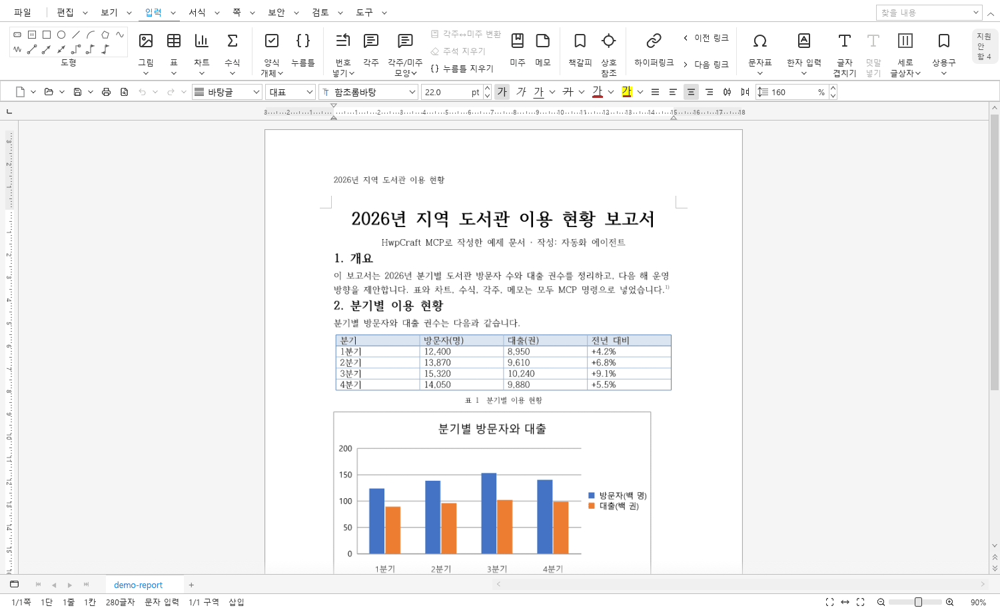
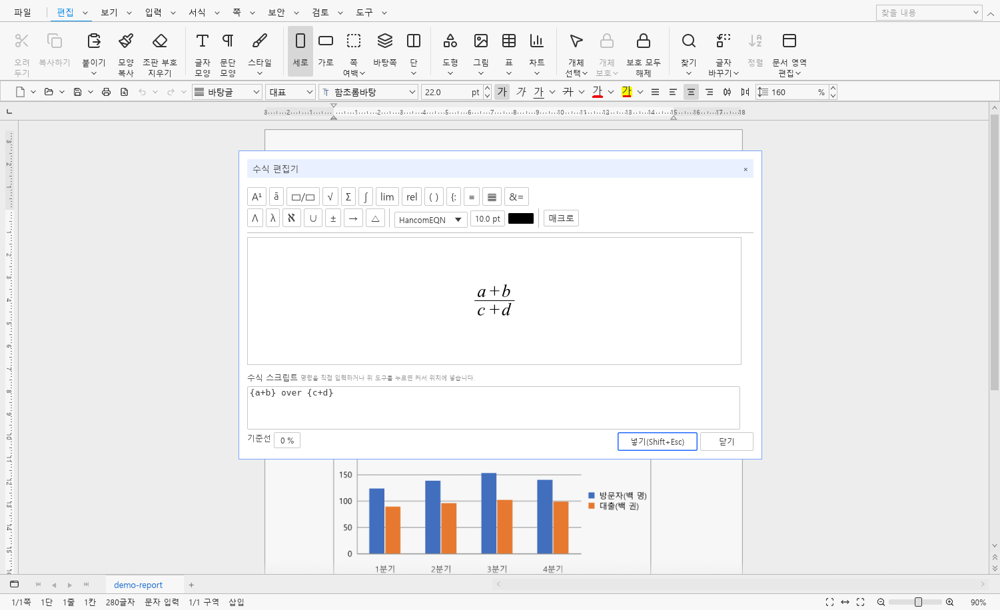
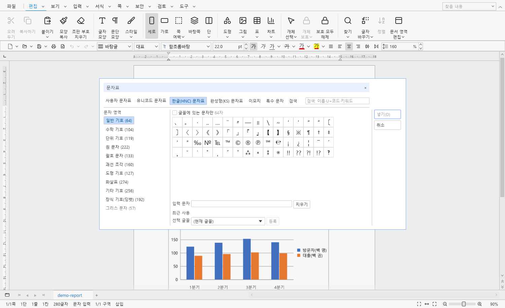
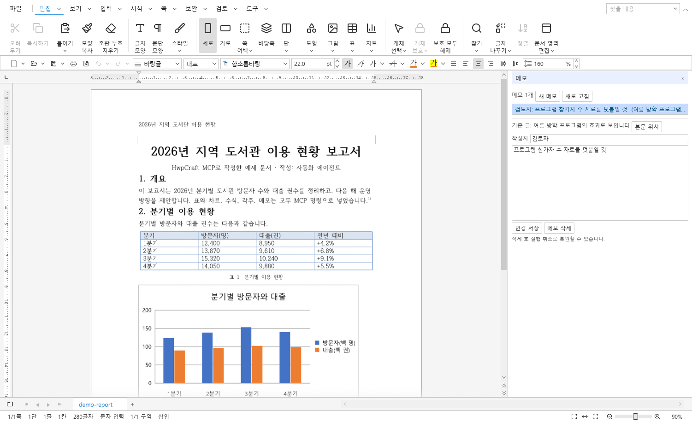
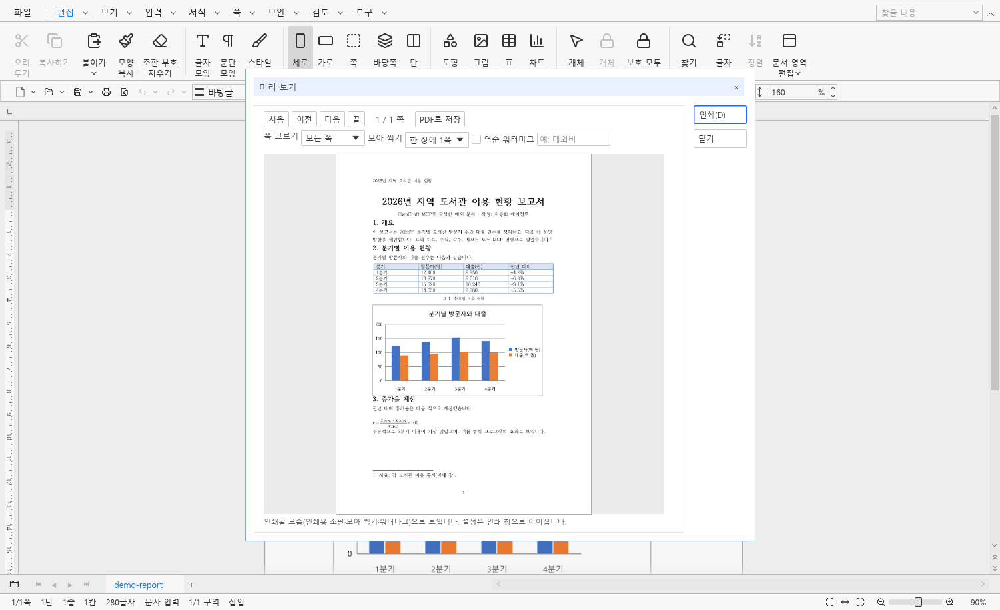
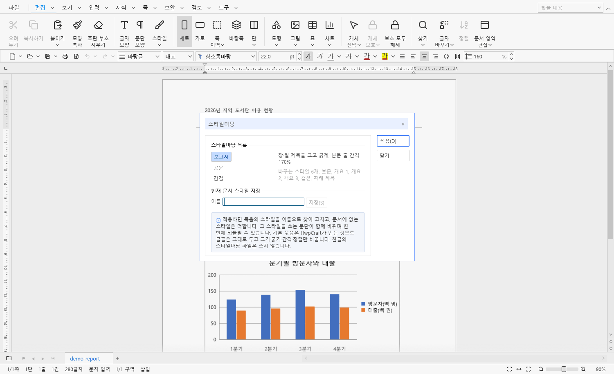
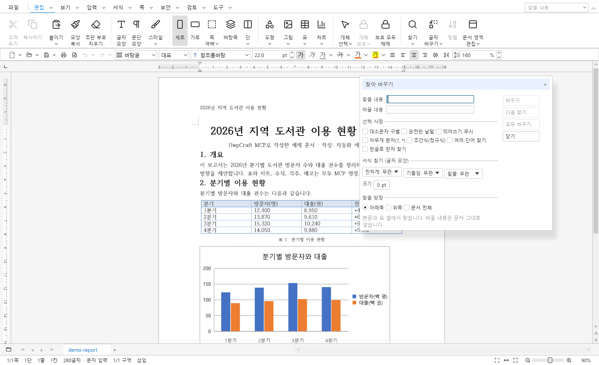
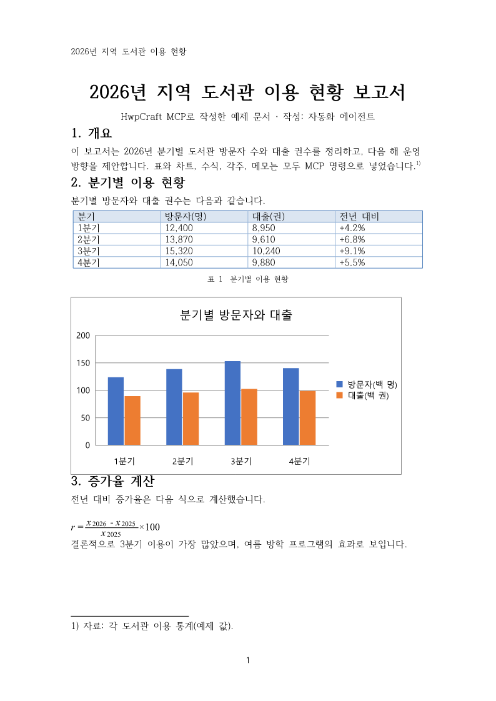

# HwpCraft

**한국어** · [English](README.en.md)

**HWP·HWPX 문서를 열고, 고치고, 저장하는 오픈소스 네이티브 편집기입니다. AI 에이전트가 MCP로 아래한글 문서를 쓰고 보고서로 완성할 수 있게 하는 문서 엔진이기도 합니다.**

버전 **0.20**(최신 배포판 [0.19](https://github.com/webvine/hwpcraft/releases/tag/v0.19)) · MIT 라이선스 · Windows · macOS · Linux · Rust



*MCP 명령만으로 만든 보고서를 데스크톱 앱에서 연 화면(입력 탭). 표·차트·각주·머리말이 모두 MCP로 들어갔습니다.*

## HwpCraft는 무엇인가요

HWP는 국내 공공기관과 기업에서 가장 많이 쓰는 문서 형식이지만, 이 형식을 편집하고 자동화할 수 있는 도구는 대부분 닫혀 있습니다. HwpCraft는 HWP와 HWPX 문서를 내 컴퓨터에서 직접 다루는 Rust 프로그램이며, 같은 편집 엔진을 세 가지 방식으로 제공합니다.

- **데스크톱 편집기**(`hwpcraft`): 아래한글과 비슷한 리본·대화상자·단축키로 문서를 편집합니다.
- **명령줄 도구**(`hwpcraft-cli`): 문서 정보 보기, 형식 변환, 쪽 그림 만들기, JSON 명령 파일로 일괄 편집을 합니다.
- **MCP 서버**(`hwpcraft-cli mcp`): Claude 같은 AI 에이전트가 문서를 만들고 고치고 저장하고 PDF로 내보내도록 편집 명령 415개를 그대로 엽니다.

ArtCraft 팀의 [WordCraft](https://github.com/storytold/wordcraft) 앱 구조 위에 [RHWP](https://github.com/edwardkim/rhwp) 문서 엔진의 아래한글 편집 기능과 [egui](https://github.com/emilk/egui) 화면을 결합해 만들었습니다. 두 프로젝트는 모두 MIT 라이선스입니다.

HwpCraft는 독립적인 오픈소스 프로젝트이며 한글과컴퓨터와 관련이 없습니다. 한컴의 코드·아이콘·로고·글꼴은 포함하지 않습니다. **아래한글의 모든 기능·화면과 100 % 같은 제품은 아닙니다.** 구현하지 않은 기능과 차이는 [현재 범위와 한계](#현재-범위와-한계)에 숨기지 않고 적었습니다.

라이선스: **MIT** ([LICENSE](LICENSE)). 적용 범위와 제3자 구성 요소는 [라이선스](#라이선스) 절을 참조하세요. 기여 방법: [CONTRIBUTING.md](CONTRIBUTING.md).

## 주요 특징

- **HWP·HWPX를 원래 모델 그대로 다룹니다.** RHWP 문서 모델을 다른 형식으로 바꾸지 않고 열고 저장하므로, 엔진이 허용하는 한 원본 개체가 남습니다. PDF·DOCX·텍스트로 내보내고 쪽을 PNG로 그립니다. 암호 문서도 엽니다.
- **아래한글에 익숙한 사람을 위한 화면.** 메뉴 탭과 상황 탭, 좁은 창에서 접히는 리본, 서식 도구 줄, 눈금자, 연속 쪽 보기, 한글식 단축키(Ctrl+K,… 같은 접두 단축키 포함), Windows 한글 입력기를 지원합니다.
- **보고서에 필요한 편집 기능.** 글자·문단 모양, 스타일과 스타일마당, 표(셀 블록·합치기·계산식·표 마당), 그림·도형·글상자·수식, 차트 15종, 각주·미주, 머리말·꼬리말, 쪽 번호, 다단, 바탕쪽, 차례·상호 참조·색인, 메모와 댓글, 찾기/바꾸기, 문서 비교와 병합, 한자 변환, 문자표.
- **AI 자동화를 위한 MCP.** MCP 서버가 stdio와 loopback HTTP로 열립니다. 최신 `2026-07-28`과 2025년 판(2025-03-26·06-18·11-25) 클라이언트를 모두 받습니다(Claude Code·Codex CLI로 확인, 0.20). 엔진 명령은 `execute`·`batch`로, 아래한글 자동화 동작 이름과 공개 ParameterSet은 `hwp_action`으로 받습니다. 실행 중인 데스크톱 창에 연결해 사람이 보는 문서를 함께 고칠 수도 있습니다.
- **문서를 망가뜨리지 않는 편집.** 저장은 임시 파일에 다 쓴 뒤 교체합니다. 실패한 명령은 문서와 실행 취소 기록을 그대로 두고, `batch {atomic:true}`는 하나라도 실패하면 처음 상태로 되돌립니다.
- **완전한 오프라인.** 로그인·서버·데이터베이스가 필요 없고 문서는 밖으로 나가지 않습니다. MCP HTTP는 127.0.0.1에서만 열리고 토큰이 있어야 합니다.

## 화면 둘러보기

| | |
|---|---|
|  |  |
| **수식 편집기** — 도구 단추와 스크립트로 수식을 쓰고 미리 보기에서 바로 고칩니다. | **문자표** — 한글의 네 가지 문자표, 이모지, 이름·코드 검색. |
|  |  |
| **메모** — 글 범위에 메모를 달고 작성자·내용을 고칩니다. 댓글도 됩니다. | **인쇄 미리 보기** — 모아 찍기·워터마크·쪽 고르기를 인쇄 전에 확인합니다. |
|  |  |
| **스타일마당** — 스타일 묶음을 골라 문서 모양을 한 번에 바꿉니다. | **찾아 바꾸기** — 띄어쓰기 무시·아무개 문자·조건식·한자·서식 조건. |

## 내려받기

[GitHub Releases](https://github.com/webvine/hwpcraft/releases)에서 운영체제에 맞는 묶음을 받습니다. 묶음마다 데스크톱 앱 `hwpcraft`, 명령줄 도구 `hwpcraft-cli`, 라이선스 파일이 들어 있습니다.

| 운영체제 | 파일 | 처음 실행 |
|---|---|---|
| Windows x64 | `HwpCraft-0.19-windows-x64.zip` | 압축을 풀고 `hwpcraft.exe` 실행 |
| macOS Apple silicon | `HwpCraft-0.19-macos-arm64.tar.gz` | `HwpCraft.app`을 우클릭 → 열기(서명·공증하지 않음) |
| macOS Intel | `HwpCraft-0.19-macos-x64.tar.gz` | 위와 같음 |
| Linux x86_64 | `HwpCraft-0.19-linux-x64.tar.gz` | `./install.sh`로 `~/.local`에 설치, 한글 글꼴(`fonts-noto-cjk` 또는 `fonts-nanum`) 필요 |

소스에서 직접 빌드하려면 [빌드](#빌드) 절을 보세요.

## 빠르게 써 보기

### 데스크톱

```text
hwpcraft 보고서.hwp
hwpcraft ./samples/HwpCraft-시작하기.hwpx
```

`samples/`에는 HwpCraft로 직접 만든 HWP·HWPX·PDF 예제가 있습니다.

### 명령줄

`hwpcraft-cli`는 데스크톱 앱과 같은 엔진으로 문서를 분석·변환·렌더·일괄 편집합니다.

```text
hwpcraft-cli --help
hwpcraft-cli commands                       # 편집 명령 목록
hwpcraft-cli info  input.hwp
hwpcraft-cli convert input.hwp output.hwpx
hwpcraft-cli render input.hwpx page.png 1
hwpcraft-cli edit --new commands.json output.hwpx
hwpcraft-cli mcp --help                     # MCP 서버
```

`edit`의 명령 파일은 `[{"command":"text.insert","params":{"text":"안녕하세요"}},{"command":"page.setup","params":{"landscape":true}}]` 형태의 JSON 배열이며 최대 1 MB / 1,000개 명령입니다. 전체 명령이 성공한 뒤에만 출력 파일을 저장합니다. 텍스트 위치(offset)는 유니코드 스칼라 값 단위입니다.

### MCP로 AI가 문서 쓰기

MCP 클라이언트 설정에 `hwpcraft-cli`를 stdio 서버로 등록합니다. 실행 파일은 절대 경로로 적고, 에이전트가 읽고 쓸 수 있는 폴더를 정해 줍니다.

```json
{
  "mcpServers": {
    "hwpcraft": {
      "command": "C:/Tools/HwpCraft/hwpcraft-cli.exe",
      "args": ["mcp", "--transport", "stdio",
               "--automation-read-root", "C:/work/reports",
               "--automation-write-root", "C:/work/reports"]
    }
  }
}
```



*위 보고서의 1쪽을 MCP `render_page`가 그린 그림. 스타일마당 적용, 글 입력, 표 채우기(`table.cells.set`), 표 마당, 캡션, 차트(`chart.create`), 수식, 각주, 메모, 머리말, 쪽 번호까지 공식 Python SDK로 MCP 도구만 불러 만들었습니다.*

에이전트는 보통 다음 순서로 일합니다. `new_document`로 문서를 만들어 `document_id`를 받고, `type_text`로 글을 넣고, `execute`·`batch`로 서식·표·그림·쪽 설정을 적용합니다. `render_page`로 쪽을 그려 확인한 뒤 `save_document`로 HWP·HWPX를 저장하고 PDF로 내보냅니다. 쓸 수 있는 명령과 인자는 `list_commands`로 찾습니다.

`hwpcraft-cli mcp`는 헤드리스 MCP 서버입니다(MCP `2026-07-28`과 2025년 판 클라이언트 지원). 기본 stdio 외에 `--transport http --listen 127.0.0.1:7082`를 지원합니다. HTTP는 loopback 주소에서만 열리고 모든 요청에 `Authorization: Bearer <토큰>`이 필요합니다. 토큰은 설정 폴더의 `mcp-http-token`(또는 `--auth-token-file`로 지정한 파일)에 있으며, 없으면 서버가 본인만 읽을 수 있게 새로 만듭니다. 요청에는 요청마다 프로토콜 `_meta`와 문서 작업의 명시적 `document_id`를 전달합니다. 한 프로세스에서 여러 문서를 격리하고 문서 생성·텍스트/서식/표/개체 편집·HWP/HWPX 저장·PDF/TXT 출력·PNG 확인·읽기/쓰기 폴더 제한을 제공합니다. `hwp_action`은 등록된 한글 동작 별칭과 일부 공개 ParameterSet을 공통 엔진으로 연결합니다. 별칭 등록이 모든 원래 옵션의 동등성을 뜻하지는 않습니다. `batch {atomic:true}`는 문서 편집을 되돌리고 파일·설정 쓰기를 사전에 거절합니다. 모든 도구는 결과 구조(`outputSchema`)를 선언하며, `execute`·`batch`처럼 명령마다 결과가 다른 부분은 공통 봉투만 고정합니다. 데스크톱 앱의 도구 탭 **MCP 연결**을 켜면 같은 서버가 그 창 안에서 `127.0.0.1:7083`으로 열리고(같은 토큰), 클라이언트는 `list_documents`로 창의 문서를 찾아 그 `document_id`로 편집합니다. 고친 내용은 창에 바로 보이고 실행 취소로 되돌릴 수 있으며, MCP로는 그 문서를 닫을 수 없습니다. 한컴 프로그램은 제어하지 않습니다. 공식 Python SDK `mcp` 2.3.0과 TypeScript SDK `@modelcontextprotocol/client` 2.4.0으로 연결을 확인했습니다.

자세한 내용: [MCP 연결과 사용법](docs/mcp.md), [명령 인자와 보고서 작성 순서](docs/mcp-commands.md).

## 최종 목표

HwpCraft의 최종 목표는 **AI가 MCP를 통해 아래한글 문서를 작성하고, 보고서·리포트로 완성해 출력하는 일을 사람 손 없이 끝까지 해내는 것**입니다. 데스크톱 편집기는 사람이 결과를 검토하고 손보는 자리이고, 자동화의 중심은 `hwpcraft-cli mcp`가 제공하는 MCP 서버입니다.

이를 위해 다음을 최대한 완성합니다.

- **문서 작성·편집의 전 과정을 MCP 명령으로 노출** — 새 문서, 텍스트 입력, 글자·문단 모양, 스타일, 표, 그림, 차트, 수식, 각주·미주, 머리말·꼬리말, 쪽 번호, 다단, 책갈피, 하이퍼링크, 찾기/바꾸기, 한자 변환, 상용구, 문서 비교까지 데스크톱에서 할 수 있는 편집은 모두 에이전트도 할 수 있어야 합니다. 아래한글 자동화 동작 이름(`hwp_action`)을 그대로 받아 기존 매크로·스크립트 지식을 재사용합니다.
- **보고서·리포트 산출에 필요한 요소를 갖춤** — 표지, 목차, 제목 체계, 번호 매기기, 표와 그림 캡션, 참조, 쪽 설정과 인쇄용 레이아웃을 명령으로 조립할 수 있게 하고, 서식 템플릿과 스타일을 적용해 일관된 문서를 만듭니다.
- **출력과 검증을 자동화** — HWP/HWPX 저장, PDF 출력, PNG 렌더로 결과를 확인하고, 일괄 명령(`batch`)이 하나라도 실패하면 문서를 되돌려 깨진 산출물을 남기지 않습니다.
- **아래한글과의 호환성** — RHWP 엔진 위에서 아래한글이 읽고 쓰는 그대로 저장하며, 지원하지 않는 기능은 숨기지 않고 [현재 범위와 한계](#현재-범위와-한계)에 적습니다.

진행 상황은 [기능 목록](docs/FEATURES.md)과 릴리스 노트(`docs/`)에, 남은 항목은 한계 절에 기록합니다.

## 구성 원리

HwpCraft는 두 오픈소스 프로젝트를 결합해 구현했습니다. 어느 부분이 어디서 왔는지 분명히 적습니다.

- **ArtCraft의 기본 구조** — storytold의 ArtCraft 팀이 만든 [WordCraft](https://github.com/storytold/wordcraft)(MIT)의 크레이트 계층(`doc` → `formats` → `render` → `engine` → `mcp` / `ui-egui` → `apps`)을 그대로 따랐습니다. 리본 너비 계획(`crates/ui-egui/src/ribbon_layout.rs`), 안전한 파일 교체(`crates/formats/src/file_access.rs`), MCP 서버의 생애주기·도구·세션 구조는 WordCraft에서 가져왔고, 화면 테마 토큰은 DesignCraft, 대화상자의 초안/확정 패턴은 DeckCraft를 따랐습니다. 앱의 뼈대와 작업 흐름은 ArtCraft 계열 프로젝트의 것입니다.
- **RHWP의 아래한글 편집 기능** — [RHWP](https://github.com/edwardkim/rhwp)(MIT)의 HWP/HWPX 파서와 문서 모델, 조판, 저장, SVG 렌더링, PDF 내보내기, 그리고 글자·문단 모양, 표, 개체, 각주·미주, 머리말·꼬리말, 쪽 번호, 다단, 책갈피, 하이퍼링크, 문서 암호, 개인 정보 검색 같은 편집 API를 그대로 호출합니다. HwpCraft는 RHWP의 문서 모델을 WordCraft의 DOCX 모델로 바꾸지 않고 유지합니다. 문서를 읽고 고치고 저장하는 능력은 RHWP의 것입니다.
- **HwpCraft가 직접 구현한 것** — 두 프로젝트를 잇는 `Session`과 명령 프로토콜(유니코드 스칼라 오프셋, 표 셀 주소, 선택·클립보드·커서, 실행 취소 트랜잭션), RHWP API를 아래한글 명령 체계로 묶은 영역별 명령 모듈, 아래한글식 리본·대화상자·단축키·IME 처리, 찾기/바꾸기·정렬·조판 부호 지우기·문자표처럼 RHWP에 없는 기능, 그리고 CLI와 MCP 노출입니다.

한글과컴퓨터의 코드·리소스는 어느 층에도 쓰지 않았습니다. 아래한글은 사용자가 기대하는 동작과 화면 배치의 참고 기준일 뿐 코드의 출처가 아닙니다.

```text
apps/hwpcraft (데스크톱)          apps/hwpcraft-cli (CLI · MCP 진입점)
        │                                   │
crates/ui-egui (리본·대화상자·IME)    crates/mcp (stdio·HTTP MCP 서버)
        └──────────────┬────────────────────┘
               crates/engine (Session · 편집 명령 · 실행 취소)
                       │
     crates/render ── crates/formats ── crates/doc
                       │
          RHWP (../rhwp: HWP/HWPX 모델·조판·저장·SVG/PDF)
```

## 기능 한눈에

| 영역 | 할 수 있는 일 |
|---|---|
| 파일 | HWP·HWPX·HWP3 열기, HWP·HWPX 저장, PDF·DOCX·TXT 내보내기, 쪽 PNG, 암호 문서, 블록 저장·끼워 넣기, 자동 복구, 문서마당 |
| 편집 | 여러 문단 선택, 한글식 커서 이동·지우기 단축키, 실행 취소 40단계, 서식 유지 복사·붙이기(HTML), 찾기/바꾸기(머리말·주석·글상자까지), 문자표, 상용구, 키 매크로 |
| 서식 | 글자·문단 모양, 스타일·스타일마당, 글머리표·문단 번호·개요 번호, 탭, 테두리·배경, 형광펜, 덧말, 문단 첫 글자 장식 |
| 표 | 표 만들기·셀 블록·합치기·나누기, 줄·칸 편집, 계산식, 표 마당·사용자 표 마당, 표 그리기·지우개, 중첩 표, 캡션 |
| 개체 | 그림(효과 포함)·도형·글상자·연결선, 수식 편집기, 차트 15종, 양식 개체, 묶기·순서·맞춤·보호 |
| 쪽·인쇄 | 편집 용지, 쪽 번호, 머리말·꼬리말, 다단, 구역, 바탕쪽, 줄 번호, 쪽 테두리·배경, 인쇄 미리 보기, 모아 찍기·워터마크 |
| 검토·도구 | 메모·댓글, 차례·표 차례·그림 차례, 상호 참조, 색인, 문서 비교·병합, 한자 변환, 개인 정보 찾아 가리기, 문서 통계 |
| 자동화 | CLI 일괄 편집, MCP 도구 16개와 편집 명령 415개, 아래한글 자동화 동작 이름(`hwp_action`) |

영역별 자세한 목록은 [기능 목록](docs/FEATURES.md)에 있습니다.

## 0.20에서 달라진 점

- **변경 추적**: 한글 변경 추적 문서를 변경 표시본으로 열고, 변경을 하나씩 또는 모두 적용·취소합니다. 기록을 켜면 본문과 표 셀의 편집을 작성자·날짜와 함께 변경으로 기록하고, HWP·HWPX로 저장해도 변경 추적이 남습니다(0.19는 이런 문서의 저장을 거절).
- **쪽·보기**: 본문 세로쓰기와 원고지, 구역 시작 위치 홀수·짝수, 구역 나누기의 바탕쪽 이어 쓰기, 마지막 쪽·임의 쪽 바탕쪽, 머리말·꼬리말 날짜 필드, 개체 이동 안내선, 창이 있는 모니터 안의 창 배열, 인쇄 창의 프린터 선택.
- **편집**: 구역을 넘는 선택과 문서 전체 모두 선택, 표 셀·글상자 안 여러 문단 선택, 중첩 표 셀 블록, 개요 번호·제목과 그림 캡션 상호 참조, 블록만큼 가로 경계선 옮기기, 데스크톱 차트 창 15종, 바깥 여백이 있는 개체를 한글처럼 그리기.
- **MCP**: 최신 `2026-07-28`과 함께 2025년 판 클라이언트도 받습니다(Codex CLI·Claude Code로 확인). stdio 요청은 보낸 순서대로 실행하고, 데스크톱 창 여러 개를 따로 연결합니다. 도구 16개를 점검하고, 편집 명령 415개 중 OS 클립보드를 쓰는 5개를 뺀 410개의 예시를 실제로 불러 오류가 없음을 확인했습니다.
- **화면과 속도**(0.19와 같은 기계에서 잰 release 빌드 값): 작은 창에서 대화상자가 스크롤되고 문맥 메뉴·글자 크기·간격을 정리했습니다. 381쪽 편람 휠 스크롤 최장 프레임 160–200 ms → 20–27 ms, 편람 HWP 저장 429 → 245 ms, 215쪽 보고서 HWP 저장 273 → 108 ms, 편람을 연 직후 상태로 실행 취소 290 → 37 ms.

전체 내용은 [0.20 릴리스 노트](docs/RELEASE-0.20.md)에 있습니다.

## 버전 이력

버전은 `0.10 → 0.11 → 0.12 …`처럼 `x.xx` 형식으로 올라갑니다(Cargo 내부 버전은 `0.10.0` 형식).

| 버전 | 주요 내용 |
|---|---|
| [0.20](docs/RELEASE-0.20.md) | 변경 추적 보기·적용·기록, 본문 세로쓰기·원고지, 구역·바탕쪽 이어 쓰기, 2025년 판 MCP 클라이언트, 화면 정리, 저장·실행 취소·스크롤 속도 |
| [0.19](docs/RELEASE-0.19.md) | 아래한글 편집 기능 넓히기(차례·상호 참조·색인·스타일마당·양식 개체·차트 15종 등), MCP 대응 명령, 조판·모두 바꾸기·PDF 속도 |
| [0.18](docs/RELEASE-0.18.md) | 차트 11종 만들기, 실패한 atomic batch의 실행 취소 기록·클립보드 복원, MCP Tasks·outputSchema·진행 알림, 편집·열기·PDF 속도, 화면 정리 |
| [0.17](docs/RELEASE-0.17.md) | 입력 대기 서식, 머리말·꼬리말·글상자·주석의 문서 영역 편집, MCP 2026-07-28(문서별 작업자, HTTP 토큰 인증), Windows·macOS·Linux 배포 |
| [0.16](docs/RELEASE-0.16.md) | 본문 메모, 중첩 표의 주소 기반 편집, 본문 자동 쪽 번호 표시, 공개 자동화 인자 일부 |
| [0.15](docs/RELEASE-0.15.md) | 문단 이동, 화면·PNG·PDF 공통 형광펜 출력 |
| [0.14](docs/RELEASE-0.14.md) | 캐럿·선택·클립보드·한글 글쇠 동작, 서식·표·개체·쪽 확장, 한자 변환·문서 비교·상용구, `hwp_action` |
| [0.13](docs/RELEASE-0.13.md) | 쓰지 않던 RHWP API 반영(암호 문서·개인 정보 찾기 등), macOS·Linux 지원 |
| [0.12](docs/RELEASE-0.12.md) | 문서 스크롤바와 문서 탭 배치 |
| [0.11](docs/RELEASE-0.11.md) | 셀 안 여백 조절, 쪽 모서리 표시 |
| [0.10](docs/RELEASE-0.10.md) | 버전 체계, Ctrl+휠 확대/축소 |

앞으로의 계획은 [기능 확장 순서](docs/FEATURE-ROADMAP.md)에 있습니다.

## 빌드

Rust 1.98.1(`rust-toolchain.toml`에 고정). Windows x64는 MSVC와 Visual Studio C++ 빌드 도구, macOS는 Xcode 명령줄 도구, Linux는 C 컴파일러와 X11/Wayland·OpenGL 개발 패키지가 필요합니다. 파일 대화상자는 xdg-desktop-portal(GNOME·KDE 기본 제공)을 쓰므로 GTK 개발 패키지는 필요 없습니다. `HwpCraft.ps1`(Windows)과 `hwpcraft.sh`(macOS·Linux: `build`, `test`, `install`, `start`, `status`)가 같은 Cargo 명령을 감쌉니다.

Windows 설치 파일: `scripts/build-installer.ps1`이 `HwpCraft.ps1 Install`과 같은 파일을 모아 Inno Setup 6으로 `packaging/windows/HwpCraft.iss`를 컴파일해 `output/installer/HwpCraft-<버전>-windows-x64-setup.exe`를 만듭니다(바탕 화면 바로 가기·`.hwp`/`.hwpx` 연결은 선택).

플랫폼 현황(0.20): Windows x64는 전체 테스트·clippy와 실제 데스크톱 화면까지 검증했고, Linux x86_64는 WSL에서 workspace 테스트를 실제로 돌렸습니다. macOS(arm64·x64)와 Linux x86_64는 GitHub Actions 릴리스 빌드에서 workspace 테스트를 실행하며, 실제 Mac·Linux 데스크톱에서 화면을 직접 확인하지는 않았습니다. 글꼴은 OS별 한글 글꼴 후보(Windows 맑은 고딕, macOS Apple SD Gothic Neo, Linux Noto Sans CJK KR·나눔고딕 등) 중 설치된 첫 글꼴을 씁니다. Linux에는 한글 글꼴(`fonts-noto-cjk` 또는 `fonts-nanum`)이 필요하며, 없으면 영문·숫자만 보이고 한글은 다른 설치 글꼴에 한글이 있을 때만 표시됩니다. 설정 폴더는 Windows `%APPDATA%\HwpCraft`, macOS `~/Library/Application Support/HwpCraft`(기존 `~/.config/HwpCraft`가 있으면 그대로 사용), Linux `$XDG_CONFIG_HOME/HwpCraft` 또는 `~/.config/HwpCraft`입니다. macOS 단축키는 Ctrl 대신 Cmd(⌘)입니다. macOS 앱은 서명·공증하지 않았으므로 처음 실행할 때 우클릭 → 열기 또는 `xattr -d com.apple.quarantine HwpCraft.app`이 필요하고, Finder에서 문서를 더블클릭해 여는 것은 지원하지 않습니다(앱 안에서 열기). Linux 배포 묶음은 압축을 풀고 `./install.sh`로 `~/.local`에 설치합니다. Launcher 등록·portable ZIP 패키징은 Windows 스크립트에만 있습니다.

HwpCraft는 RHWP를 **형제 폴더 경로 의존성**(`../rhwp`, RHWP **v0.8.7**, 커밋 `1a76570e`)으로 사용합니다. 두 저장소를 같은 상위 폴더에 받으세요.

```text
git clone https://github.com/webvine/hwpcraft.git
git clone --branch v0.8.7 https://github.com/edwardkim/rhwp.git
cd hwpcraft
cargo build --release --locked -p hwpcraft -p hwpcraft-cli
cargo test --locked --workspace
cargo clippy --locked --workspace --all-targets -- -D warnings
```

엔진 테스트 하나가 `../rhwp/samples`의 차트 예제를 열므로 RHWP 체크아웃에 `samples` 폴더가 있어야 합니다. HwpCraft가 RHWP에 적용하는 로컬 패치는 `patches/rhwp/`에 있습니다. 빌드 전에 `pwsh -File scripts/rhwp-patches.ps1 -Mode Apply`로 적용하세요(`scripts/sync-siblings.ps1`은 RHWP를 최신화한 뒤 자동으로 다시 적용합니다). Windows에서는 `HwpCraft.ps1`(`Build`, `Test`, `Install`, `Start`, `Status`)이 같은 명령을 감싸며 `../.build/hwpcraft`를 Cargo 빌드 폴더로 씁니다. `Launcher`·`Install` 동작은 이 저장소에 포함되지 않은 로컬 런처를 대상으로 합니다.

데스크톱 앱 실행:

```text
hwpcraft ./samples/HwpCraft-시작하기.hwpx
hwpcraft ./samples/HwpCraft-시작하기.hwpx --view replace --screenshot out.png --exit-after-screenshot
```

`--view`는 실제 화면 확인용으로 대화상자나 리본 탭을 바로 엽니다(예: `character`, `paragraph`, `table-create`, `page-setup`, `find`, `replace`, 리본 탭 이름 `insert` 등).

`cargo fmt --all`은 경로 의존성을 따라 RHWP까지 포맷하므로 실행하지 마세요. HwpCraft 패키지는 `-p`를 명시해 포맷합니다.

## 구조

| 경로 | 역할 |
|---|---|
| `crates/doc` | 문서 엔진 노출, 유니코드 커서와 표 셀 주소 |
| `crates/formats` | HWP/HWPX 읽기·저장, PDF/TXT 내보내기, 안전한 파일 교체 |
| `crates/render` | RHWP SVG → resvg 쪽 이미지, 얇은 선 처리, 설치 글꼴 목록 |
| `crates/engine` | Session·명령 프로토콜, 선택·클립보드·커서, 찾기, 정렬·조판 부호, 탭 폭 저장, 서식, 표·개체, 쪽 서비스 |
| `crates/mcp` | stdio·loopback HTTP MCP 서버, 문서 격리·헤드리스 편집·도구·리소스·프롬프트·명령 안내 |
| `crates/ui-egui` | 메인 창·연속 쪽 보기·키보드/IME, 리본·도구줄·눈금자·상태 표시줄, 영역별 대화상자 |
| `apps/hwpcraft` | eframe/glow 데스크톱 실행 파일 |
| `apps/hwpcraft-cli` | 문서 분석·변환·PNG 렌더·명령 일괄 편집 CLI, MCP 진입점 |
| `samples` | HwpCraft로 직접 생성한 HWP/HWPX/PDF 예제 |
| `docs` | 설계 노트·검증 기록·릴리스 노트 |

영역별 모듈은 `extensions.rs`를 통해 연결되어 각 영역이 자기 파일에서 명령·대화상자·단축키를 추가합니다.

## 문서

| 문서 | 내용 |
|---|---|
| [기능 목록](docs/FEATURES.md) | 영역별 기능 상세 |
| [MCP 연결과 사용법](docs/mcp.md) | 연결, 메타데이터, 문서 핸들, 도구, 파일 권한, Tasks |
| [MCP 명령 인자](docs/mcp-commands.md) | 명령별 인자와 예제, 보고서 작성 순서 |
| [MCP 구현](docs/mcp-implementation.md) · [MCP 검증](docs/mcp-verification.md) | 서버 구조와 검증 기록 |
| [표 조작](docs/TABLE-INTERACTION.md) | 표 선택·이동·크기 조절 동작 |
| [기능 확장 순서](docs/FEATURE-ROADMAP.md) | 다음 버전 계획 |
| [릴리스 노트](docs/RELEASE-0.19.md) | 버전별 변경(`docs/RELEASE-0.xx.md`) |

## 현재 범위와 한계

### 구현하지 않음(리본·메뉴에서 비활성)

- MCP: 데스크톱 창 연결은 창에 열린 문서 하나를 편집하며, 클릭/키 입력/창 캡처, 원격 인증, 전체 선택 확장은 없습니다(공식 적합성 시험은 준비 자료가 있는 시나리오를 모두 통과). MCP `2026-07-28`과 2025년 판(2025-03-26·06-18·11-25) 클라이언트를 모두 받습니다(Codex CLI·Claude Code·Python SDK 1.x/2.x 확인, 0.20). HTTP는 loopback만 허용하며 문서별 명시 ID를 사용합니다. stdio에서는 한 문서에 보낸 요청이 보낸 순서대로 실행되지만, HTTP로 동시에 보낸 요청은 순서가 정해지지 않으니 응답을 받은 뒤 보내거나 batch를 쓰세요. 데스크톱 창 문서의 PDF 저장은 여러 프레임에 나눠 준비해 창이 멈추지 않지만, HWP/HWPX 저장은 한 번에 실행됩니다(큰 문서 1초 남짓). 연결 취소가 이미 실행된 동기 편집이나 파일 쓰기의 rollback을 보장하지 않습니다. 실행 중에 취소된 저장은 파일 교체 직전에 멈춰 기존 파일을 남깁니다. 긴 작업의 진행 알림은 5초 간격 경과 시간이며 쪽 단위 진행률이 아닙니다. Tasks 확장은 열기·저장 도구에만 적용하며 상태는 tasks/get 폴링으로만 알 수 있습니다(task 알림 없음).
- 보안 탭: 배포용 문서로 저장(배포용 문서는 읽기 전용으로 열어 보기·쪽 이미지만 되고, 편집·저장·복사·인쇄/PDF·본문 글자 추출은 데스크톱·MCP·CLI 모두 거절합니다), 선택 글자 보호·개인 정보 보호 해제·보호 암호 변경·문서 보안 설정(한글의 암호화 개인 정보 필드와 설정 형식이 공개되지 않아 지원하지 않음, 다른 문서에 있는 그 필드는 그대로 보존, 대신 개인 정보 찾아서 가리기), 보안 종류 선택(RHWP는 한 가지). 검토·도구: 교정 부호, 문서 이력의 새 버전 기록·이전 버전 보기(기록된 목록은 봄), 서식 변경의 변경 추적 기록, 맞춤법, 빠른 교정의 한글 기본 목록(사용자 목록은 지원: 데스크톱에서 친 글에만 적용하고 바로 Ctrl+Z로 되돌림), 사용자 사전, 번역, 스크립트(JavaScript) 매크로, 인용(색인은 0.19부터 됩니다: 낱말 뒤에 한글과 같은 색인 표시를 넣고 고치고 지우며(첫째·둘째 키, HWP/HWPX), 캐럿 위치에 한글 2024 색인 만들기 기본 모양으로 색인을 넣습니다 — 첫소리 묶음, '낱말<탭>쪽, 쪽', 둘째 키는 들여 씀. 한글은 새 문서에 만들고 HwpCraft는 캐럿 위치에 넣으며, 색인 표시가 든 문단은 문서 병합·서식 상용구로 가져오지 못합니다. 차례는 개요 문단이나 스타일로, 표 차례·그림 차례는 캡션 달린 표·그림으로 만들 수 있습니다. 모두 "차례 N"·"표 차례"·"그림 차례" 스타일의 일반 문단으로 넣으며, 한글의 차례 필드는 쓰지 않습니다. 새로 고침 한 번이 세 차례를 모두 고칩니다. 항목 글은 그 제목·표·그림 문단의 책갈피로 가는 하이퍼링크이며(한글 저장본의 책갈피 링크 형식, DOCX에서는 문서 안 링크), MCP·엔진은 `hyperlink.jump` 계열로, 데스크톱은 Ctrl+클릭으로 따라갑니다. PDF에서도 차례 항목과 상호 참조를 누르면 그 쪽으로 갑니다(0.19, RHWP 패치 0039; 모아 찍기 인쇄본과 PDF에 없는 쪽으로 가는 링크는 빠짐), 환경 설정. 상호 참조는 개요·캡션 달린 표와 그림·책갈피가 있는 쪽 번호, 표와 그림의 캡션 번호(한글처럼 숫자만)와 캡션 전체를 넣고 새로 고칩니다(한글과 같은 상호 참조 필드로 HWP/HWPX에 저장. 그림 참조는 한컴 공개 규격을 따랐고 한글 실측은 표만 했습니다). 한글이 HWPX 저장본의 표 번호·캡션 참조 필드를 그렇게 읽는지는 아직 확인하지 못했습니다. 개요도 표·그림처럼 보이는 번호("2.")와 제목을 참조합니다(0.20, 한글 2024 실측 형식). 개요 문단 맨 앞에서 Enter로 문단을 나누면 그 개요를 가리키던 상호 참조가 HWPX 저장 뒤 끊길 수 있으니, 새로 고치기 전에 다시 넣으세요. 상호 참조는 표 셀 안(한 단계 셀)과 표·그림·책갈피·각주 같은 개체가 든 문단에도 넣을 수 있습니다. 다만 개체 바로 뒤 자리에는 넣지 못하므로 한 글자 떨어진 자리에 넣어야 합니다(RHWP 패치 0067). 나중에 참조 끝에 개체가 붙으면 새로 고칠 때 그 참조는 건너뛰고 결과의 skipped로 알립니다. 날짜 필드 새로 고침도 한 단계 표 셀 안의 필드까지 고칩니다. 키 매크로는 편집 명령·키 입력·캐럿/셀 이동을 기록해 이름으로 저장·실행하며(마우스로 옮긴 캐럿은 기록하지 않음), 실행 중 실패하면 실행 전으로 되돌립니다. 문서 비교·한자 변환·상용구는 아래에 적은 제한 범위에서 지원합니다.
- 보기: 개체를 끌면 쪽·본문·다른 개체의 가장자리와 가운데에 맞추는 개체 이동 안내선을 그립니다(보기 → 안내선, Alt는 자유 이동). 창 배열은 창이 있는 모니터의 작업 영역 안에서 하고, 모두 아이콘으로를 지원합니다(모니터 하나인 PC에서만 실제 확인, 여러 모니터는 해석·고르기만 시험). macOS에서는 메뉴·툴팁·상태 표시줄의 단축키를 ⌘로 표시합니다. 데스크톱 MCP 연결은 창마다 켤 수 있고, 먼저 켠 창부터 7083, 7084 … 포트를 씁니다(7099까지). 클라이언트에는 창마다 다른 이름으로 그 주소를 등록합니다. 문서 보기 색은 화면 후처리로 지원합니다. 파일: 한컴 기본 서식(문서마당은 사용자가 저장한 서식만 제공), HML 원본이 아닌 문서의 HML 저장. 자동 복구는 바뀐 문서를 쉴 때 5분마다 설정 폴더 `recovery`에 사본으로 저장하고, 비정상 종료 뒤 다음 시작 때 복구를 제안합니다(원본 파일은 건드리지 않음).
- 쪽: 세로쓰기 구역의 표·그림·각주 그리기. 본문 세로쓰기(영문 눕힘·세움, 한 열·한 쪽에 드는 글자 수는 한글 2024 실측에 맞춤), 구역 시작 위치(그대로·홀수로·짝수로, 한글처럼 빈 쪽 없이 쪽 번호만 건너뜀), 머리말·꼬리말의 만든 날짜·저장한 날짜 필드, 원고지(400자 A4 세로·200자 A4 가로, 칸마다 한 글자, 영문·숫자는 두 자가 한 칸, 줄 끝 공백 매달림)는 지원합니다. 구역 나누기는 한글처럼 앞 구역의 바탕쪽을 이어 씁니다. 인쇄: 인쇄 창에서 프린터를 고를 수 있습니다(실제 종이 인쇄는 운영체제 프린터 명령). 라벨(A4 규격 표, 새 쪽 추가하기)·모아 찍기(1·2·4·8쪽)·워터마크(인쇄물에만)·홀짝·역순·부수는 지원합니다.
- 서식: 스타일 가져오기/내보내기와 스타일마당은 HwpCraft JSON 형식이며, 한글의 스타일마당 파일(.sty)과 한글 기본 스타일마당 목록은 쓰지 않습니다.
- 표·개체: 사진 편집, 글맵시·일반 OLE 생성은 미지원입니다. 새 차트는 위의 15종·본문 명령 범위입니다. 입체 꺾은선(line_3d)·표면형(surface)은 미지원이고, 거품 크기는 `chart.configure`로만 바꿉니다(`chart.data`는 X·Y 값). 데스크톱 차트 창에서도 15종을 모두 만듭니다(창을 처음 열면 미리 보기가 잠시 '만드는 중'으로 나옴). 중첩/그룹 도넛 표시와 한컴 네이티브 호환성은 미완료입니다. 수식 시각 편집은 미리 보기 위 커서·입력·빈 칸 이동과 끌어서 범위 선택을 지원합니다(아래 스크립트 칸은 선택을 보이지 않고 캐럿만 따라감). 세로 글상자·개체 맞춤·개체 선택 단추는 기본 경로를 지원합니다. 연결선 부착 좌표는 종이 기준 개체에 정확하고 문단 기준 개체는 어긋날 수 있으며, 직선 끝점 편집은 글자처럼 취급한 직선·연결선을 제외합니다.
- HwpCraft에서 새로 만든 문서(또는 HwpCraft가 저장한 HWPX를 연 문서)는 HWPX로 저장할 때 줄 배치 정보(linesegarray) 없이 저장되어, 한글과 HwpCraft가 열 때 다시 조판합니다. 한글에서 연 문서는 원본 줄 배치를 보존하지만, 많이 고친 문단에는 RHWP가 계산한 낡은 줄 배치가 남을 수 있습니다.
- 탭 ∨ 목록은 한글 하위 메뉴가 아닌 리본 명령 목록입니다.
- 표 직접 이동은 한 쪽 안의 최상위 표가 대상입니다. 글자처럼 취급한 표는 한글처럼 놓은 본문 글자 자리로 옮겨지고(`object.move_inline`), 떠 있는 표는 위치가 옮겨집니다. 여러 쪽에 걸친 표는 속성으로 조절하세요. 셀 간격이 있는 표도 표 그리기·지우기가 되며, 좌표는 셀 간격을 뺀 셀 격자(`table.info`)입니다. RHWP는 셀 간격을 앞 셀 안에 넣어 그려 셀 사이 틈이 보이지 않습니다.

- 표 안의 표(중첩 표) 셀과 글상자는 0.19부터 쪽 화면에서 바로 편집합니다: 그곳을 누르면 캐럿이 놓이고 글 입력(한글 입력기 포함)·Backspace·Delete·Enter(문단 나누기)·방향키·Home/End·Shift 선택·Ctrl+Z·Ctrl+B/I/U·복사·붙여넣기가 되며, 편집마다 실행 취소 한 단계입니다(RHWP 패치 0046). Home/End는 줄의 처음·끝, 더블/트리플 클릭은 낱말·문단 선택, 중첩 표에서 Tab/Shift+Tab은 다음·앞 셀(글상자에서는 탭 문자)이고, 리본·서식 도구 줄의 글자·문단 서식 단추도 그 캐럿에 적용됩니다. Esc나 본문 클릭으로 본문 캐럿에 돌아갑니다. 글상자는 한글처럼 글 위를 누르면 캐럿이, 테두리 근처(4 px 안)를 누르면 개체 선택이 되고, 선택한 글상자를 끌면 옮겨집니다. 선택은 한 셀·글상자 안의 여러 문단에 걸칠 수 있고(다른 셀로 넘어가는 선택은 아직 없음), 글자 모양·문단 모양 대화상자도 그곳의 모양을 보여 주고 바꿉니다(0.20). 중첩 표에서 다른 셀까지 끌면 셀 블록이 골라지고, 리본의 셀 합치기·나누기·줄/칸 넣기·지우기가 그 표에 적용됩니다(엔진·MCP `context.table.merge`·`split`·`insert_row`·`insert_column`·`delete_row`·`delete_column`·`cells`(테두리·배경)·`info`, 0.20). 묶음 안 글상자와 아래 영역은 다음 메뉴로 고칩니다.
- 중첩 표와 머리말·꼬리말·글상자·주석은 편집 탭의 **문서 영역 편집** 메뉴에서 문자/문단 서식·나누기/합치기·표 생성/삭제를 수행합니다. 글자처럼 취급한 개체는 끌어서 다른 글자 자리로 옮기고(`object.move_inline`, 메모·누름틀 시작에서는 안쪽·끝에서는 바깥쪽), 여러 개 선택한 떠 있는 개체는 함께 옮깁니다(`object.move_by`). 세로 글상자도 같은 경로로 고칠 수 있습니다(`context.v2.*`). 세로 머리말·꼬리말은 아직 읽기 전용입니다. 세로쓰기 구역의 본문은 편집할 수 있습니다(↑↓는 열 안, ←→는 열 사이, 캐럿은 열을 가로지르는 막대). 그 안의 중첩 영역(표 셀·글상자)은 읽기 전용입니다. 세로쓰기 구역의 가운데·오른쪽 정렬은 열 가운데·아래 끝에 맞춥니다. 양쪽·배분 정렬은 글자 사이를 벌리지 않고 열 위부터 놓으며, 문단 여백·들여쓰기는 열 시작 자리에 반영하지 않습니다(한글 세로 문서와는 표본이 없어 대조하지 못함). 공개 인자 `CharShape`·`ParagraphShape`·`TableCreate`는 `hwp.parameters.schema`로 지원 필드를 조회할 수 있습니다.

### 남아 있는 조판·저장 한계

- 메모 해결 상태는 한글에 없는 기능이라 두지 않습니다. 여러 문단에 걸친 메모는 한글 저장본처럼 첫 문단에 시작, 마지막 문단에 끝 표식을 두어 만들고 지웁니다(같은 구역의 본문 문단만, 댓글은 아직 안 됨). 댓글이 있는 메모를 HWPX로 쓸 때 끝 표식(fieldEnd) 순서가 한글과 다릅니다(HwpCraft는 바깥 메모부터 닫고 한글은 안쪽부터 닫음, 짝은 beginIDRef로 맞음). 한글이 저장할 때 마지막 저장 날짜 필드의 글을 바꾸는지는 확인하지 못했습니다. HwpCraft는 저장 때 요약 정보의 시각만 갱신하고 필드 글은 새로 고침 명령으로 바꿉니다. 날짜 필드는 한글 표본처럼 월·일·시에 0을 채우지 않고, HWPX에는 확인된 Command 매개 변수만 씁니다.

- 큰 표가 많은 일부 HWP 문서는 쪽 나눔이 한글과 다를 수 있습니다. 『2025 행정업무운영 편람(최종)』의 .hwp는 381쪽으로 조판되어 한글(383쪽, KoPub 글꼴이 없으면 384쪽)보다 적습니다. 부록 규정 표처럼 셀 안에서 여러 쪽에 걸치는 큰 행을 한글보다 조금 더 채워 나누기 때문이며, 같은 문서의 .hwpx는 383쪽으로 맞습니다. 같은 편람 제5장 질의응답 표 가운데 질문 51 표가 한글보다 크게 그려져 뒤 쪽의 표 배치가 한글과 어긋나고, .hwp 299쪽의 표는 마지막 행 압축 때문에 첫 조각이 본문 하단을 약 5 px 넘습니다. RHWP의 HWP5 조판 경로에서 생기는 편차로, RHWP에서 추적 중인 알려진 문제(#6842)입니다.
- 그림 효과(그림자·네온·부드러운 가장자리·반사)는 `picture.effects`로 넣을 수 있고, HWP·HWPX 모두 저장·다시 열기·그리기를 지원합니다(.hwp에서 연 효과도 그립니다, 0.20). 네온·부드러운 가장자리·반사 모양과 HWP에 쓰는 효과 색은 아직 한글과 대조하지 않았습니다.
- DOCX 내보내기는 글자·문단 모양, 표(병합·테두리·배경), 그림, 수식(그림으로), 머리말·꼬리말과 쪽 번호, 각주·미주, 다단을 씁니다. 본문을 밀어내는 도형·글상자·차트는 쪽 화면에서 잘라 그림으로 넣고, 글 뒤·글 앞 도형과 표·머리말 안 도형은 넣지 않습니다. 떠 있는 그림·표는 제자리(글자처럼)에 놓이며, 결과에 담지 못한 것 목록을 돌려줍니다(MCP `omitted`, CLI 오류 출력, 데스크톱 메시지 줄). DOCX 가져오기와 ODT는 아직 지원하지 않습니다.
- 줄 번호: 구역마다 켜고 시작 번호·번호 간격·본문과의 거리·번호 매기기(쪽마다·구역마다·이어서)를 정하며(`page.line_numbers`, 쪽 → 줄 번호, 구역 설정), 화면·PDF의 본문 줄에 번호를 그립니다(RHWP 패치 0020·0037). 설정은 HWP·HWPX 어느 쪽으로 저장해도 남습니다. 표·글상자·각주·머리말/꼬리말 안의 줄은 세지 않고, 번호의 위치·글꼴은 한글 화면과 대조하지 못했습니다. 번호 매기기 값(`restartType`)의 뜻은 공개 문서에 없어 한글 자동화 표(`LineNumberRestart`)를 따랐습니다(미확인). PDF에서는 번호가 글자로 들어가 글자 추출 결과에도 나옵니다(쪽 글 뒤에). 문단의 "줄 번호 건너뜀"(쪽 → 줄 번호 → 현재 문단 건너뜀, `page.line_numbers.skip`)은 HWPX에서 읽고 저장하고 그릴 때 지킵니다(RHWP 패치 0042). HWP 파일에서의 자리는 공개된 HWP 5.0 문서에 없어 HWP는 읽지도 쓰지도 않으므로, HWPX 원본을 HWP로 저장하면 건너뜀이 사라집니다.
- 문단 테두리 위·아래 간격은 한글처럼 문단 높이에 넣지 않고 테두리 상자만 그만큼 키웁니다. 그래서 간격이 문단 사이보다 크면 테두리가 이웃 문단과 겹쳐 보입니다(한글도 같음). 좌우 간격과 일부 선 종류(이중선 등)는 단선으로 그려집니다.
- 덧말 기준 글자 폭은 줄 나누기에 들어갑니다(0.20). 문단 맨 끝의 덧말은 아직 폭 없이 셉니다.
- 바깥 여백이 있는 개체는 한글처럼 여백만큼 안쪽에 그립니다(글 앞·뒤 표와 도형의 왼쪽·위 정렬, 그림은 전부). 가운데·오른쪽·아래 정렬, 쪽 기준 가로 위치의 표, 글자처럼 취급한 개체는 근거가 없어 종전대로 그리고, 여러 쪽에 이어지는 글 앞·뒤 표의 다음 조각은 아직 위 여백만큼 높게 그립니다. 저장본에는 영향이 없습니다.
- 바탕쪽 그림·도형은 바탕쪽 창과 엔진·MCP(`page.master.object.*`)로 종이 위 자리(mm)에 넣고 지웁니다. 바탕쪽의 그림·도형·글상자·표는 `page.master.object.list`의 주소(`master` 포함)로 본문과 같은 개체 명령(`object.properties`, `object.size`, `object.move_by` 등)을 써서 크기·자리를 바꾸고(바탕쪽 창의 고치기), 바탕쪽 글과 그 안의 표 셀·글상자 글은 `context.v2.*`(`include`에 `master_page`)로 문단 단위로 고칩니다. 떠 있는 표가 든 바탕쪽도 `page.master.set`으로 글 전체를 바꿀 수 있습니다(표는 첫 문단에 남음). 글자처럼 취급한 표나 쪽 번호 같은 조판 부호가 든 바탕쪽은 글 전체 바꾸기만 하지 않고, 같은 종류의 바탕쪽이 둘 이상 읽힌 구역은 편집하지 않습니다. 바탕쪽 개체를 문서 화면에서 끌어 옮길 수는 없습니다.
- 한글에서 만든 HWPX를 편집해 HWPX로 다시 저장하면, 편집한 문단의 줄 배치는 한글이 다시 조판하도록 비워 둡니다. 그래서 HwpCraft로 다시 열면 쪽 나눔이 편집할 때와 달라질 수 있습니다(HWP로 저장하면 그대로입니다).
- HwpCraft에서 새로 만든 문서를 HWP로 저장하면 줄 배치를 구현 행(HWP 줄 정보 bit31 '구현상 편의 속성')으로, HWPX로 다시 읽을 때와 같은 새 조판 값으로 저장합니다. 한글이 이런 HWP를 여는 모습은 아직 실측하지 못했습니다(RHWP 샘플 HWP 2개에 같은 표시가 있음).
- 형광펜은 markpen으로 저장하고 HwpCraft가 공통 SVG 경로에 합성해 화면·PNG·PDF/인쇄에 표시합니다. 본문·표 셀·중첩 표·머리말·꼬리말·각주·미주·글상자 안의 형광펜을 그립니다(머리말·꼬리말은 그려지는 모든 쪽에). 묶음 안 글상자와 머리말 안 표는 빠집니다. 새 번호 목록은 새 번호 정의로 저장합니다(RHWP `set_numbering_restart`는 저장되지 않음). 곡선은 촘촘한 직선 구간으로 저장합니다.
- 새로 만들거나 편집한 중첩 표는 조상 셀의 필요한 높이를 보정합니다. 가져온 문서의 짧은 셀 프레임은 화면 표시용으로만 보정하며(원본·저장본은 그대로), 열기가 멈추지 않도록 문서마다 정해진 작업량 안에서만 보정합니다. 한도를 넘는 문서와 128쪽을 넘는 문서는 일부 또는 전체 표를 원본 배치 그대로 표시하므로 깊은 중첩 표가 잘려 보일 수 있습니다.
- 행·열 수가 실제 셀보다 작게 기록된 손상 표는 열 때 실제 셀 범위로 보정합니다.
- 쪽 번호·전체 쪽수는 본문과 표 셀(중첩 표 포함)·글상자·각주·미주 안에서도 그 내용이 놓인 쪽의 번호를 글자 모양, 번호 모양, 여러 자리 폭을 반영해 화면·PNG·PDF에 동적으로 표시합니다(쪽마다 반복되는 표 제목 줄은 쪽마다 제 번호, 머리말·꼬리말·바탕쪽은 RHWP가 쪽마다 그림). 세로쓰기 셀·글상자, 묶음 개체 안 글상자, 각주·미주 안 표·글상자의 번호는 RHWP 표시(아라비아 숫자, 폭 예약 없음)를 따릅니다. 쪽 번호 필드를 새로 넣는 것은 아직 본문에서만 됩니다. 번호로 쪽 경계가 달라지면 HWP/HWPX/TXT 쪽 추출은 거절하며 PDF 쪽 저장은 지원합니다. 쪽 번호 필드가 있는 문서는 본문 글자 입력·삭제만 해당 문단을 다시 배치하고(381쪽 문서 약 40 ms), 문단 나누기 등 다른 편집은 표시용 문서 전체를 다시 조판합니다(약 0.3초). 날짜 코드는 현재 날짜 글로 넣습니다.
- 표: 셀 음영 진하게/연하게는 한글처럼 처음 색에서 한 단계까지만 바뀌고, 반대쪽을 누르면 처음 색으로 돌아갑니다(다른 편집을 하면 그때 색이 새 기준이 되며, 한글이 기준색을 언제까지 기억하는지는 실측하지 못한 추정입니다). 셀 블록 안 경계선을 끌면 한글처럼 블록의 줄·칸에서만 옮겨집니다(`table.move_border`의 `range`, 세로·가로 모두). 가로 경계선의 블록 이동은 셀 내용보다 작아지는 이동, 여러 쪽에 걸친 표, 셀 간격이 있는 표, 중첩 표(`context.table.move_border`)에서는 거절합니다. 이렇게 어긋난 표에 줄·칸을 넣으면 새 줄도 표 격자에 맞춰집니다(RHWP 패치 0027). 표 마당의 글자 모양 적용은 없습니다. 사용자 표 마당(`table.user_style.*`, 설정 폴더 table_styles)은 테두리·배경·대각선만 셀 위치(첫/가운데 홀짝/마지막 줄·칸)별로 저장하고 글자 모양은 저장하지 않습니다. 표 만들기 창에서는 표 마당을 고를 수 없습니다(표를 만든 뒤 표 디자인 탭에서 적용). 개체: 그림 그림자·네온·옅은 테두리·반사(RHWP는 보존만), 그리기 마당·서식 저장은 없습니다. 표 셀 안에서 넣은 그림은 그 셀 왼쪽 위에 떠 있는 그림(어울림)으로 들어갑니다. 셀 안에 글자처럼 넣기는 아직 없습니다. 자유선은 끄는 대로, 곡선은 한글처럼 점을 찍어 그리며, 둘 다 짧은 선분 곡선으로 저장합니다. 바깥 여백·글상자 여백 사전 값과 그림자 이동 단위는 한글 수치를 확인하지 못한 가정값입니다. 각주 번호 '쪽마다 새로'는 화면·PDF에서 각주가 있는 쪽마다 시작 번호부터 다시 매기고(본문 각주 표시와 각주 영역 모두, RHWP 패치 0036), 파일에는 이어지는 번호를 저장합니다. 각주·미주 구분선 길이는 한글 사전 값 5 cm(−1)와 미주의 단 너비(−4), 직접 지정 0–115 mm(HWP 16비트 한도)만 받습니다.
- 쪽 복사/지우기는 그 쪽에 놓인 글 범위대로 합니다(여러 쪽에 걸친 문단은 그 쪽 부분만). 끼워 넣기는 파일 메뉴에서만(Ctrl+O는 불러오기). PDF 인쇄 옵션(형광펜·그리기 개체·그림·메모 포함)은 RHWP에 옵션이 없어 제공하지 않습니다. 문서 이력 관리(검토 탭, `review.history.list`)는 한글이 HWP에 기록한 버전(날짜·작성자·설명)을 보여 주기만 하고, 마지막 이력 버전을 HML로 따로 저장할 수 있습니다(`review.history.save_last`). 새 버전 기록, 이전 버전 보기·되돌리기(버전 사이 차이 적용)는 하지 않으며, 그 HML은 한글이 HWPML 2.5로 기록해 HwpCraft가 열지 못합니다. 기록은 HWP로 저장해도 그대로 남고, HWPX의 이력은 읽지 않습니다. 쪽 윤곽(Ctrl+G,L)을 끄면 쪽마다 본문만(위·아래 여백, 머리말·꼬리말·쪽 번호 없이) 이어 보이고 쪽 경계는 점선입니다. 화면에서만 바뀌고 왼쪽·오른쪽 여백은 그대로입니다. 격자는 화면에만 그리는 5 mm 선입니다. 맞쪽 보기는 쪽 배치만 바꾸며 쪽 번호 안/바깥 구분은 없습니다.
- 글 상용구 외에 서식·표·내장 그림·기본 도형을 포함한 본문 상용구를 별도 저장소로 지원합니다. 본문 캐럿 자리에 넣습니다(0.19부터 문단 중간도: 표 없는 한 문단은 글 사이에 이어지고 여러 문단은 나눈 문단 사이에 들어감). 표 셀 안 넣기, 그룹·차트/OLE 조각과 범용 외부 교환은 미지원입니다.
- 한자 변환은 Unicode Unihan 독음표로 음절마다 후보를 고르는 방식이며 낱말 사전이 없어 아래한글처럼 낱말 단위 후보·빈도순 정렬은 하지 않습니다. 맞춤법 검사는 미지원입니다. 한글 변경 추적 문서(HWP·HWPX)는 변경 표시본으로 열리며, 삽입한 글은 파란 밑줄, 삭제한 글은 빨간 취소선, 서식 변경은 초록 밑줄로 화면·PNG·PDF에 그립니다(본문과 표 셀). 변경 목록(종류·글·작성자·날짜)을 보고 변경을 하나씩 또는 모두 적용·취소할 수 있고, 변경 추적 기록을 켜면 본문과 표 셀의 글자 입력·지우기·문단 나누기·합치기를 작성자·날짜와 함께 변경으로 기록합니다(검토 메뉴, MCP `document.track_changes`·`.accept`·`.reject`·`.record`, 한 번에 되돌림). HWP·HWPX로 저장하면 고쳤든 아니든 변경 추적을 그대로 둡니다: 고치지 않은 HWP는 원본 바이트대로, 고친 HWP는 모든 변경을 적용한 결과본(BodyText)과 변경 표시본(ViewText)을 함께 쓰고, HWPX는 insertBegin·deleteBegin 표식과 헤더의 변경·작성자 목록을 씁니다. 변경 추적 문서 9개로, 모두 적용한 결과가 한글이 저장한 결과본과 같음을 확인했습니다. 검토 탭에서 변경 추적을 켜고 끄고, 캐럿이 있는 변경이나 모든 변경을 적용하거나 되돌리며, 이전·다음 변경으로 이동합니다(표 셀 안 변경 포함). 상태 표시줄은 변경 추적 기록과 기록 중 여부를 보여 줍니다. 한계: 서식 변경은 옛 서식을 알 수 없어 취소하지 못하고 기록하지도 않습니다. 기록 중에는 서식·개체·표 구조·구역 편집과 서식 있는 붙여넣기를 거절합니다. 중첩 표·머리말·각주·글상자 안의 변경은 목록에 넣지 않습니다. DOCX·쪽/블록 저장·암호를 건 HWP는 변경 기록을 담지 못해 결과본으로만 저장합니다. 기록 켜짐 상태는 파일에 저장하지 않습니다. HwpCraft가 기록·저장한 변경 추적 파일과 HWPX 표식(OWPML 명세 기반, 변경 추적이 든 HWPX 실표본 없음)은 한글에서 열어 보는 확인을 아직 하지 못했습니다. 메모는 본문·표 셀 범위의 CRUD·작성자·댓글까지 지원합니다(해결 상태는 한글에도 없음, 여러 문단 범위 메모는 0.20부터 본문에서 만들고 지움). 문서 비교는 추가·삭제·변경 문단 목록과 현재 글·비교 파일 글을 나란히 놓은 목록을 보여 주고, 고른 차이를 비교 파일 쪽으로 병합합니다(0.19, `review.merge.plan`·`review.merge`, 서식·표·그림도 가져오고 한 번에 되돌림). 두 문서를 화면에 나란히 놓고 함께 넘겨 보는 보기와 변경 추적으로 병합하기는 없고, 구역 수가 다르면 같은 번호의 구역끼리만 맞대며, 개체가 있는 구역 첫 문단은 병합으로 지우지 않습니다. 음영 없음은 RHWP가 흰색(#ffffff)으로 보고합니다.
- 구역 나누기(`page.section_break`)는 캐럿 자리부터 새 구역을 만들고 쪽 설정·단 설정을 이어받습니다. 머리말·꼬리말은 한글처럼 다음 구역으로 이어집니다. 새 구역은 한글처럼 바탕쪽을 따로 두지 않고 앞 구역의 양쪽·홀수·짝수 바탕쪽을 이어 씁니다(RHWP 패치 0061). 그래서 한 구역의 바탕쪽을 고치면 그것을 이어 쓰는 뒤 구역도 함께 바뀌고, 한글에서 나눈 문서의 뒤 구역에도 앞 구역 바탕쪽이 보입니다. 새 구역 첫 쪽의 바탕쪽 감추기도 따릅니다. 마지막 쪽·임의 쪽 바탕쪽은 이어 쓰지 않고 그것을 둔 구역에만 그립니다(이 부분은 한글과 대조하지 못함). 구역 첫 문단 처음에서 Backspace, 앞 구역 끝에서 Delete를 누르면 두 구역이 합쳐지고 앞 구역의 설정·바탕쪽을 따릅니다(문단은 그대로 두고, 한 번 더 누르면 문단이 합쳐집니다).
- 한글처럼 홀수·짝수 바탕쪽은 그 쪽에서 양쪽 바탕쪽 대신 쓰이고, 저장 순서와 구역 플래그도 한글과 같습니다. 바탕쪽은 양쪽·홀수·짝수·마지막 쪽·임의 쪽(구역 안 n번째 쪽)을 만들고 고칠 수 있습니다. 임의 쪽 바탕쪽은 HWPX에만 저장됩니다. HWP 형식에는 그 쪽 번호를 담을 자리가 없어서, .hwp 저장은 이유와 대안(.hwpx로 저장하거나 임의 쪽 바탕쪽을 지우기)을 알리고 거절합니다(데스크톱·MCP save_document·CLI convert 모두 같음). HWP 파일에서 읽은, 쪽 번호가 없는 임의 쪽 바탕쪽은 보기와 저장만 됩니다. 홀수 쪽이나 짝수 쪽 바탕쪽 하나만 있는 구역은 한글이 그 쪽에만 그리지만 RHWP는 모든 쪽에 그립니다. 문서 요약 정보, 쪽 테두리의 홀수/짝수·첫 쪽만·그림 채우기, 글맵시·일반 OLE 생성은 미지원입니다. 양식 개체는 넣기와 속성(이름·글·글꼴·글자/배경 색·크기·테두리 그리기·사용 가능·인쇄·콤보 목록·라디오 묶음·입력 상자 읽기 전용/여러 줄/숫자만/최대 길이/암호 문자, `form.properties`) 고치기를 지원합니다(0.20). 테두리 채우기와 글자 정렬은 고칠 수 없고, 콤보 상자 목록은 HWPX에만 저장됩니다(HWP는 한글이 문서 스크립트에 두는데 RHWP가 쓰지 않음). 선택 상자·라디오 단추의 배경 색은 저장되지만 화면에 그려지지 않습니다. 차트는 위의 자체 11종 생성·구성 명령 범위와 한계를 따릅니다. 스타일 추가·고치기·지우기는 RHWP wasm 래퍼에만 있어 HwpCraft가 모델을 직접 고칩니다. 줄 단위 커서 이동·선택 영역 좌표 조회는 RHWP 비공개라 캐럿 좌표로 계산합니다.
- 탭 폭은 본문·표 셀·중첩 표·머리말·꼬리말·각주·미주·글상자에서 저장할 때 채웁니다(묶음 안 글상자와 머리말 안 표는 폭 0으로 저장).
- 본문 선택은 한글처럼 구역을 넘을 수 있고 전체 선택은 문서 전체입니다(0.20). 구역을 넘는 선택을 지우면 그 구역들이 하나로 합쳐집니다(구역 경계 지우기와 같음). 구역을 넘는 선택의 복사는 글자만 복사하고, 정렬·문자열을 표로·블록 저장(`file.save_block`)은 한 구역 안의 선택만 받습니다. 표 셀 선택은 한 셀 안입니다.
- 글자처럼 취급한 개체 때문에 높아진 줄에서 ↓를 누르면 바로 아래 줄을 건너뛰고 그다음 줄로 갈 수 있습니다(0.19에서는 움직이지 않았음).

### 검증 한계

- 인쇄는 HwpCraft가 쪽 범위·홀짝·역순·여러 벌 모아 찍기·용지 방향·2/4/8쪽 모아 찍기·워터마크를 적용한 PDF를 만들어 인쇄 창에서 고른 프린터(고르지 않으면 운영체제 기본 프린터)로 보냅니다. 그 PDF는 0.19에서 44쪽 보고서로 옵션마다 장 수와 각 장의 쪽을 HwpCraft PDF 저장본과 대조했습니다(가로 원본의 2·8쪽 모아 찍기는 세로 장에 위아래로). 그 뒤 드라이버까지는 확인하지 못했습니다. 이 검증 PC는 기본 프린터가 종이 프린터이고, Windows 11 기본 PDF 앱(Edge)에 인쇄 동사가 없어 HwpCraft는 PDF를 열어 주기만 합니다(부수는 그 창에서 다시 정함). Microsoft Print to PDF는 파일 이름 창이 떠서 자동으로 보내지 못했습니다.
- 표 선택·이동·크기 조절에는 포인터 이벤트 회귀 검사가 있습니다. 앱 전체 기능의 클릭·끌기 E2E 검증을 완료한 것은 아닙니다.
- 복잡한 실제 문서의 편집 후 왕복 저장, 대용량 문서·표 성능은 충분히 검사하지 않았습니다. 장시간 입력은 0.19에서 데스크톱 앱(release)에 IME 조합·확정 이벤트로 1만 자씩 넣어 보았습니다(`--view bench-ime`). 44쪽 보고서와 381쪽 편람 모두 메모리는 실행 취소 40단계 상한 덕분에 평탄했고(약 370 MB / 830 MB), 저장·재열기한 보고서는 49쪽이 모두 같았습니다. 실제 Windows IME로 치는 시험은 대화형 화면이 없는 검증 환경이라 하지 못했습니다. 중요한 문서는 원본을 유지하고 다른 이름으로 저장한 뒤 한글에서도 확인하세요.
- 문서 입력 크기는 128 MB, 한 번의 텍스트 삽입은 1 MB로 제한합니다. 파싱·렌더링이 동기식이라 복잡한 문서에서 UI가 잠시 멈출 수 있습니다. 큰 문서의 PDF 저장은 시간이 걸립니다(381쪽 문서 약 17초, 쪽을 최대 8개 스레드에서 나눠 변환하며 이때 메모리를 약 1.9 GB까지 씁니다. `RHWP_PDF_THREADS`로 스레드 수를 조절합니다).

릴리스 노트는 `docs/`에 있습니다.

## 기여하기

버그 보고와 풀 리퀘스트를 환영합니다. 먼저 [CONTRIBUTING.md](CONTRIBUTING.md)를 읽어 주세요.

- 기여물은 MIT 라이선스로 제공되며, 모든 커밋은 `git commit -s`로 서명(DCO)합니다.
- 편집 명령은 `crates/engine`에 두어 데스크톱·CLI·MCP가 함께 씁니다.
- 실패한 열기·명령·저장이 현재 문서나 기존 파일을 망가뜨리면 안 됩니다.
- 구현하지 않은 기능과 호환성 한계는 이 README에 숨기지 않고 적습니다.
- 글꼴·아이콘은 재배포가 허용된 라이선스만 쓰고, 한컴의 코드·리소스는 넣지 않습니다.
- AI 도구로 작성한 코드는 사람이 검토하고 책임지며 서명한 경우에만 받습니다.
- 올리기 전에 `cargo test --locked --workspace`와 `cargo clippy --locked --workspace --all-targets -- -D warnings`를 통과시킵니다.

## 라이선스

HwpCraft는 **MIT 라이선스**로 배포합니다. 전문은 [LICENSE](LICENSE)에 있으며, 저작권자는 HwpCraft 기여자들입니다.

**MIT 라이선스가 적용되는 범위** — 이 저장소에 들어 있는 HwpCraft의 모든 산출물입니다.

- 소스 코드: `crates/`, `apps/`의 Rust 코드와 빌드·패키징 스크립트(`HwpCraft.ps1`, `hwpcraft.sh`).
- 문서와 예제: `README.md`, `docs/`, `CONTRIBUTING.md`, `samples/`의 HWP/HWPX/PDF 예제 문서.
- HwpCraft가 직접 만든 자산: 앱 아이콘 `assets/icon.svg`, 리본 아이콘 아틀라스 `assets/toolbar-icons.png`(Lucide 아이콘을 조합한 결과물).
- 기여물: 풀 리퀘스트로 들어오는 모든 변경은 MIT로 제공되며 DCO 서명을 요구합니다([CONTRIBUTING.md](CONTRIBUTING.md)).

**제3자 구성 요소** — 각자의 라이선스를 그대로 따르며 MIT로 재라이선스하지 않습니다. 전문은 `assets/licenses/`에, 목록은 `THIRD-PARTY-NOTICES.txt`에 있습니다.

| 구성 요소 | 라이선스 | 위치 |
|---|---|---|
| [RHWP](https://github.com/edwardkim/rhwp) 문서 엔진 (Edward Kim) | MIT | 별도 저장소(`../rhwp`, v0.8.7), 바이너리에 링크. HwpCraft의 로컬 수정은 `patches/rhwp/`의 패치 파일로 두며 RHWP의 MIT 라이선스를 그대로 따릅니다 |
| WordCraft · DeckCraft · DesignCraft에서 가져온 코드 (ArtCraft 팀) | MIT | `ribbon_layout.rs`, `file_access.rs`, `chrome.rs` 등 파일 머리에 표시 |
| [Lucide](https://lucide.dev) 아이콘 | ISC | `assets/icons/lucide/` |
| egui 기본 글꼴: Hack, Noto Emoji, Ubuntu, emoji-icon-font | MIT, OFL 1.1, UFL 1.0, MIT | 바이너리에 포함 |
| Rust 크레이트 의존성 (`Cargo.lock`) | MIT, Apache-2.0, BSD, ISC 등 허용적 라이선스 | `THIRD-PARTY-DEPENDENCIES.md` |

의존성 중 라이선스를 선택할 수 있는 크레이트는 MIT 또는 Apache-2.0으로 사용합니다. GPL이나 AGPL만으로 배포되는 코드는 없습니다.

**포함하지 않는 것** — 한글과컴퓨터의 프로그램 코드, 아이콘, 로고, 글꼴, 서식, 클립아트는 소스와 바이너리 어디에도 없습니다. "한글", "한컴", "HWP", "HWPX"는 각 권리자의 상표이며 MIT 라이선스는 상표 사용권을 부여하지 않습니다. 이 저장소에서는 파일 형식 호환성을 설명하기 위해서만 언급합니다.

바이너리를 재배포할 때는 `LICENSE`, `THIRD-PARTY-NOTICES.txt`, `assets/licenses/`의 라이선스 전문을 함께 배포하세요. 패키징 스크립트가 이를 자동으로 복사합니다.

## 감사의 글

- [RHWP](https://github.com/edwardkim/rhwp) (MIT) — HWP/HWPX 문서 엔진.
- [Lucide](https://lucide.dev) (ISC) — `assets/icons/lucide`의 리본 아이콘. `assets/toolbar-icons.png`로 조합합니다.
- [WordCraft](https://github.com/storytold/wordcraft), DeckCraft, DesignCraft (MIT, ArtCraft 팀) — 크레이트 구조, 리본 너비 계획, 파일 교체, MCP 구조, 대화상자 초안/확정 패턴. 라이선스는 `assets/licenses/`와 `THIRD-PARTY-NOTICES.txt`에 보존합니다.
- [egui](https://github.com/emilk/egui)/eframe, [resvg](https://github.com/linebender/resvg) 및 `Cargo.lock`의 크레이트들.

한글과컴퓨터, 한글(Hangul), HWP는 각 권리자의 상표이며 파일 형식 호환성을 설명하기 위해서만 언급합니다.
